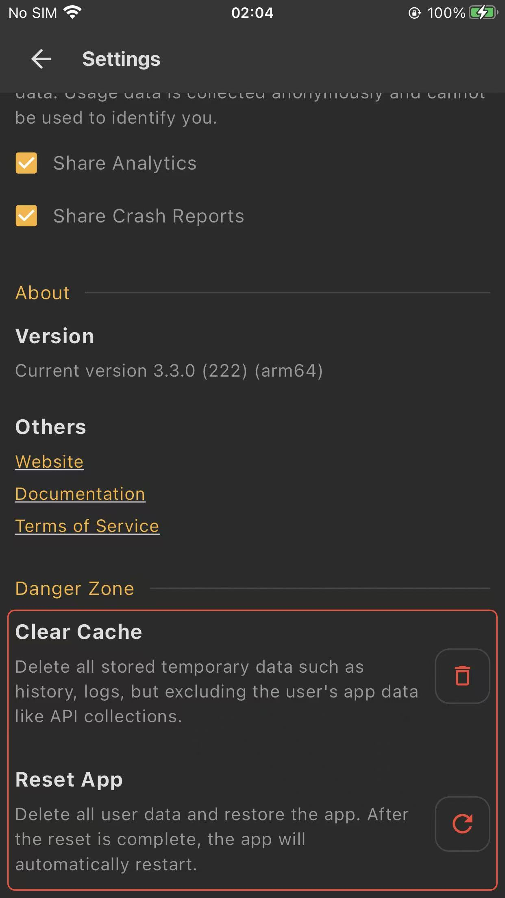
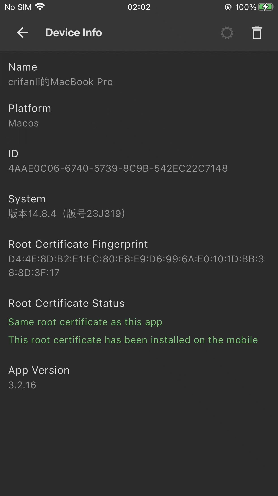
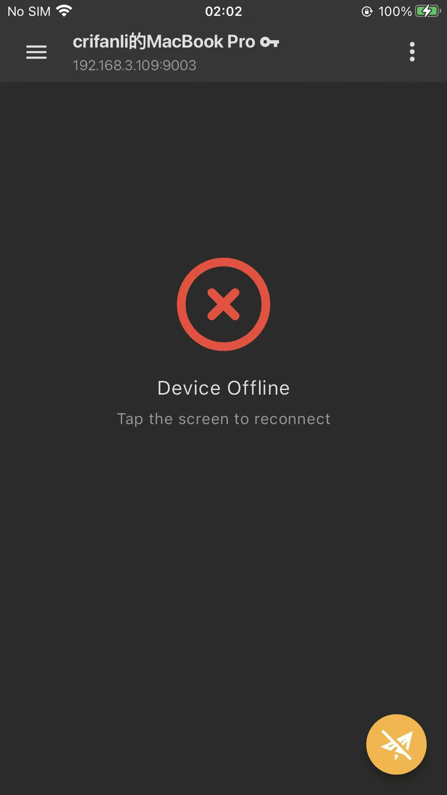
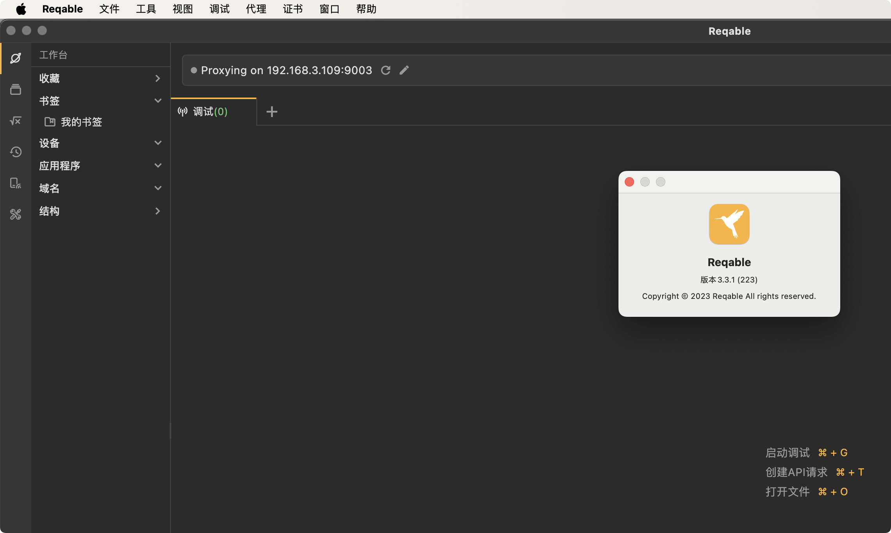

# 版本要一致

Reqable使用期间，遇到过不止一次的问题，都是由于：版本不一致导致的。

所以此处的经验之一就是：一定要确保版本一致。

具体说就是：

* **移动端**（`Android`/`iOS`等）和**电脑端**（`Mac`等）中的Reqable的版本尽量一致

具体遇到过的问题是：

* iPhone中的Reqable好像是2.x的版本，但是Mac中Reqable已升级到3.0版本，导致：Reqable死活无法正常工作
* 概述：iPhone中Reqable已经是最新的：`3.3.0`，但是和Mac中的Reqable是稍微旧一点的：`3.2.6`，导致了iPhone中Reqable，始终报错：`Device Offline，Tap the screen to reconnect`
  * 细节：
    * iPhone中`3.3.0`的Reqable：
      * 
    * Mac中`3.2.6`的Reqable：
      * 
    * 报错：`Device Offline，Tap the screen to reconnect`
      * 
  * 解决办法：
    * Mac端安装升级到了最新版本：`3.3.1`
      * 
