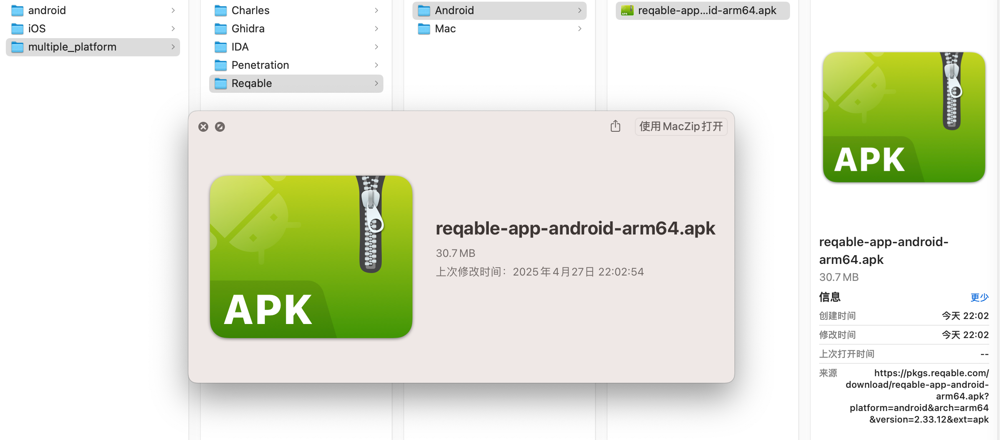
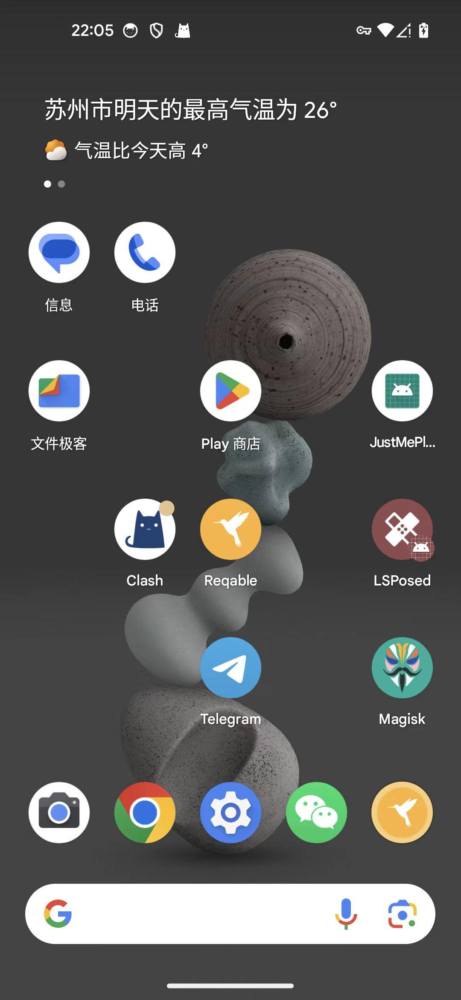

# Android中下载和安装Reqable

从官网 [客户端下载 | Reqable](https://reqable.com/zh-CN/download/) 去找到安卓版本：

此处下载地址是：

https://api.reqable.com/download?platform=android&arch=arm64&ext=apk&locale=zh

继续下载得到：

https://pkgs.reqable.com/download/reqable-app-android-arm64.apk?platform=android&arch=arm64&version=2.33.12&ext=apk

* reqable-app-android-arm64.apk
  * 

下载到Google Pixel5中

此处采用adb去直接安装：

```bash
➜  Android pwd
/Users/crifan/dev/dev_tool/_reverse_security/multiple_platform/Reqable/Android
➜  Android ll
total 61472
-rw-r--r--@ 1 crifan  staff    29M  4 27 22:02 reqable-app-android-arm64.apk
➜  Android adb install reqable-app-android-arm64.apk
Performing Streamed Install
Success
```

再去Android中看到桌面有了Reqable的图标了：


