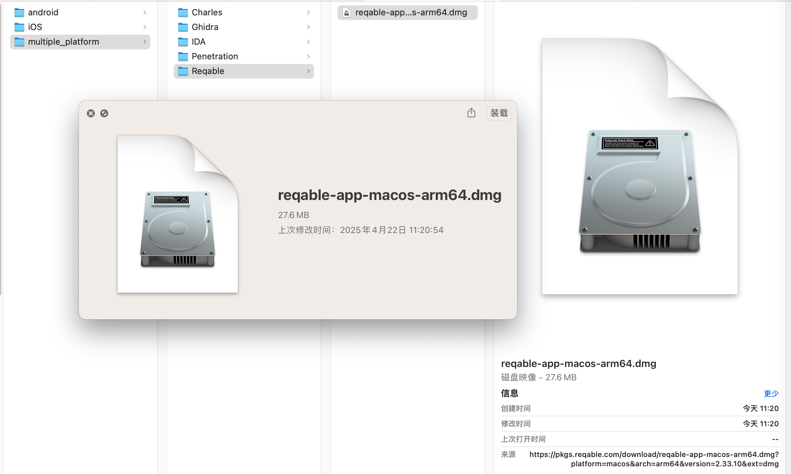
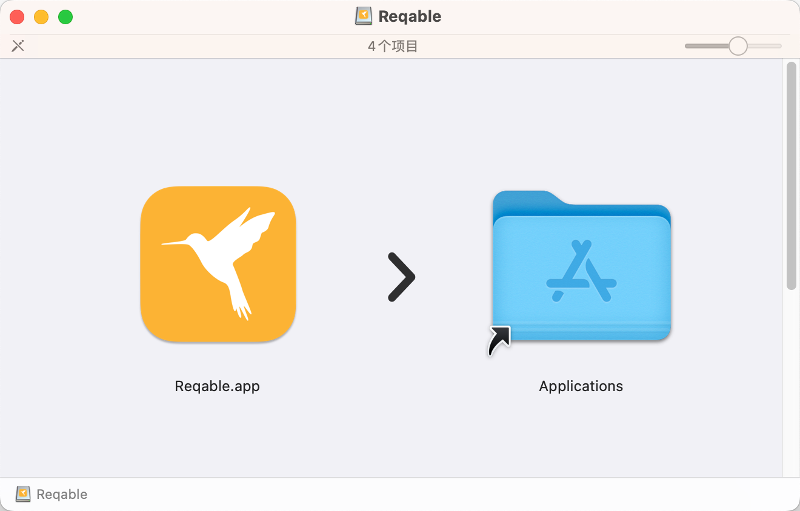
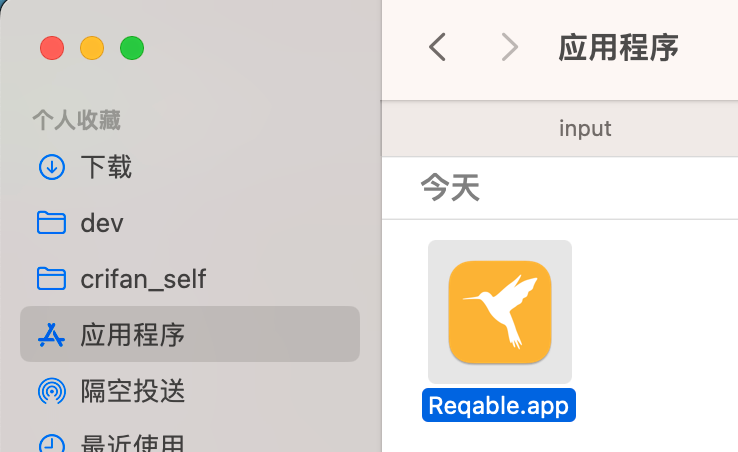
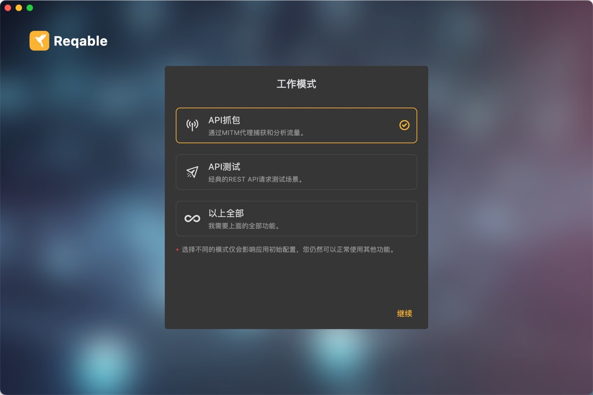
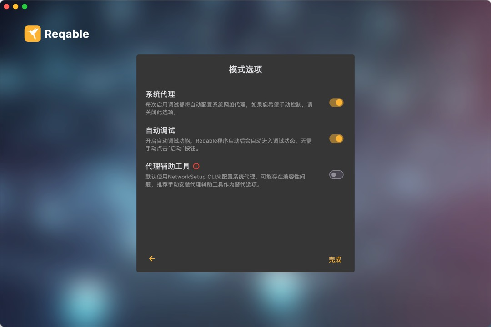
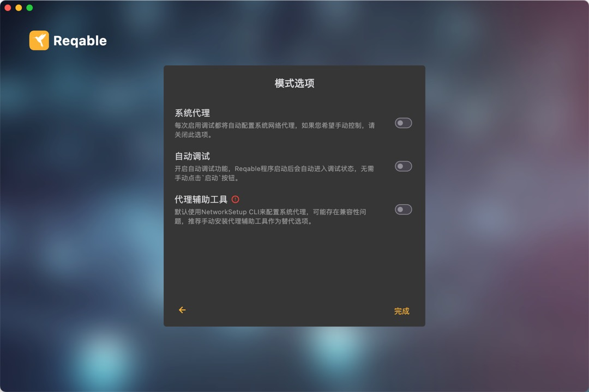
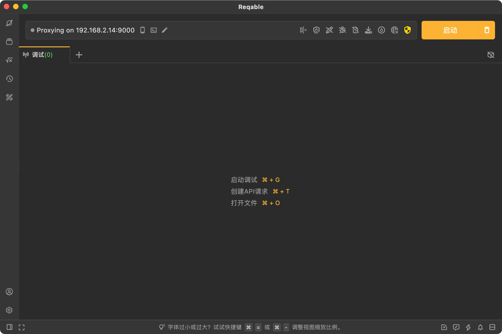
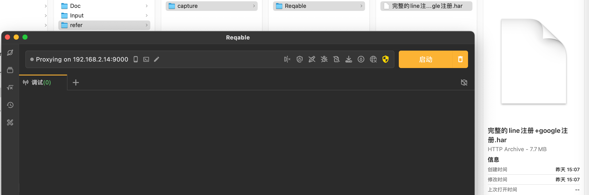
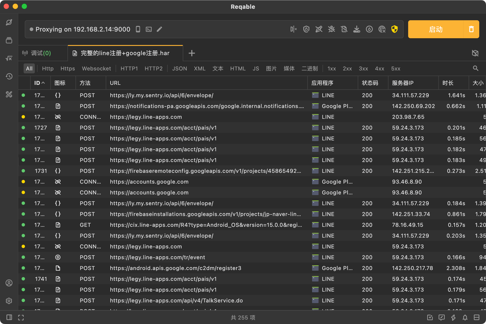
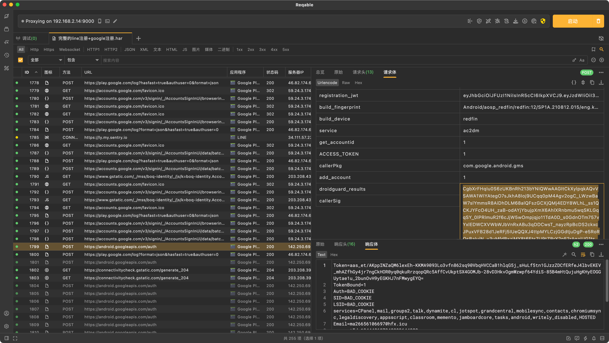

# Mac

## Mac中下载和安装Reqable
给Mac中安装Reqable：

去官网 []客户端下载 | Reqable · API抓包调试 + API测试一站式工具(https://reqable.com/zh-CN/download/) 去下载对应版本，此处是Mac M2 是Apple Silicon的ARM芯片，所以是：

[reqable-app-macos-arm64.dmg](https://app.reqable.com/download?platform=macos&arch=arm64&ext=dmg&locale=zh-CN)

下载到：`reqable-app-macos-arm64.dmg`

双击dmg，拖动到 应用程序 目录：

即可在 应用程序 中看到：Reqable

## Mac中打开和初始化设置Reqable

双击启动后：

设置工作模式，此处选择：`API抓包`

再设置模式选项细节：

默认：开启了：`系统代理`，开启了`自动调试`，此处暂时不用，所以去关闭掉：

进入主界面了：

## Mac中使用Reqable

此处可以去打开之前的抓包文件har：

看看效果：

此处去搜索之前关注的点：`droidguard_results`，可以找到结果：

即可。
