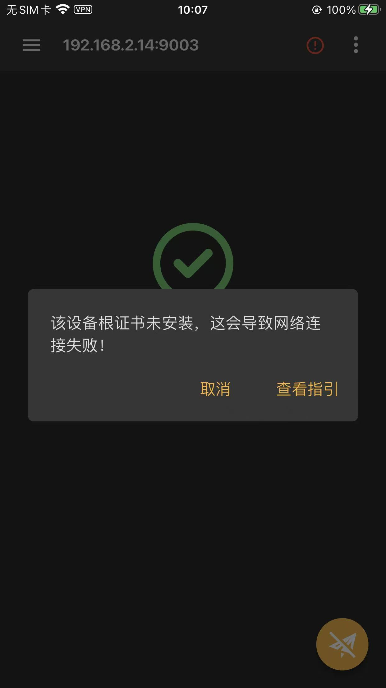
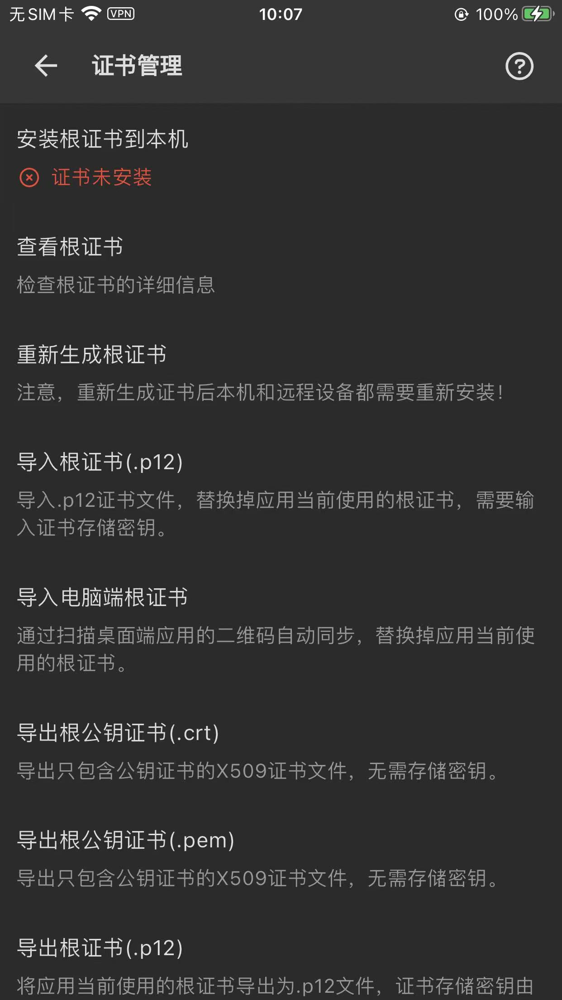
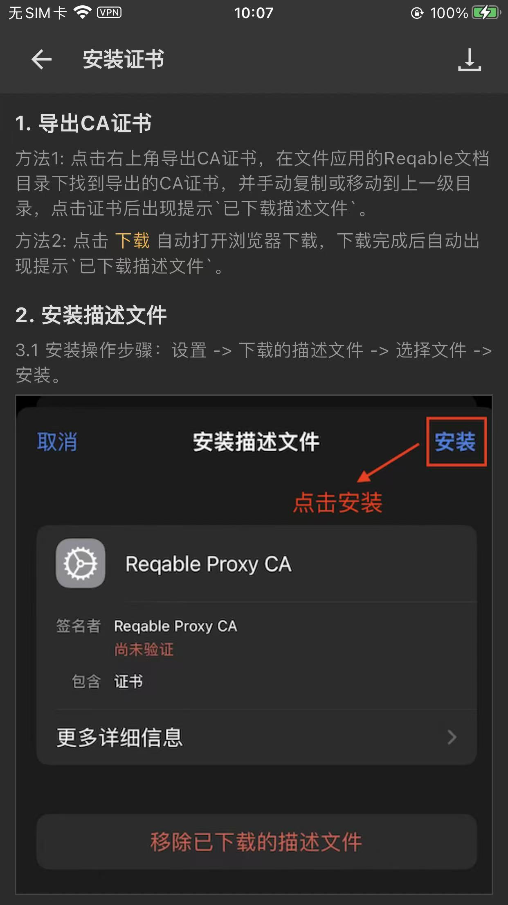
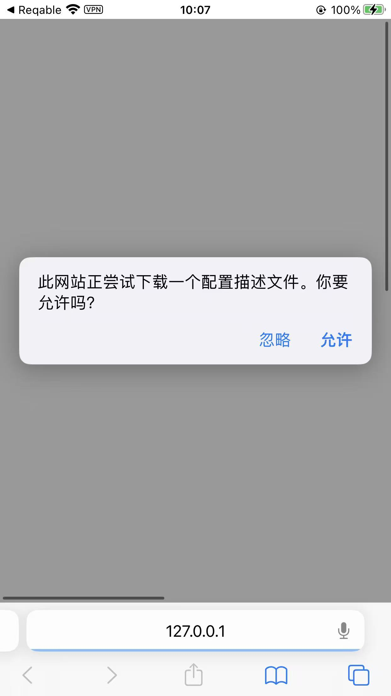

# 直接触发SSL根证书的下载

* 从移动端Reqable直接触发（SSL根）证书的下载

另外有个细节，值得记录一下：

可以从iPhone中的Reqable移动端，直接点击下载SSL根证书：

移动端Reqable扫码电脑端后，SSL根证书还没安装呢

右上角会有个红色感叹号

点击后，弹框：

点击：查看指引，进入：证书管理：

点击：证书未安装

进入 安装证书 页面：

点击：下载

会自动触发，打开浏览器，弹框下载证书的提示

（注意，此时浏览器显示地址是：127.0.0.1，表示是本机IP）

后续即可继续点击允许，即可开始下载证书了

* 对比：之前都是自己手动操作的：
  * 先要给WiFi加代理，再去到浏览器中输入地址，才能触发的
    * 这里，移动端直接操作，更加方便
