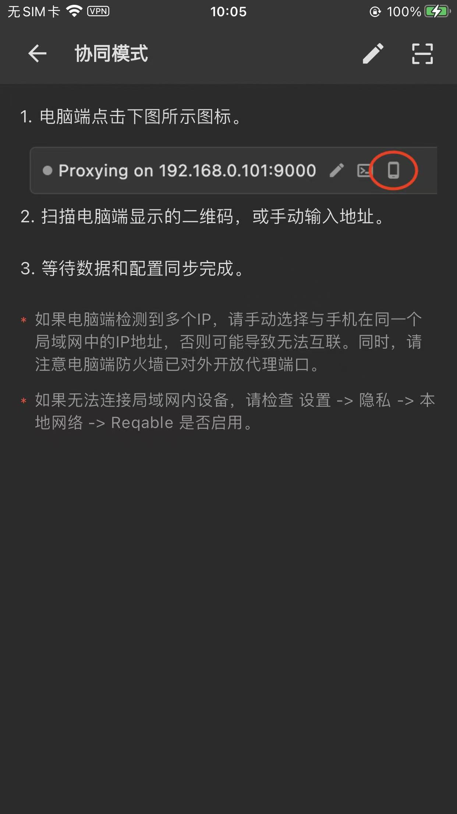
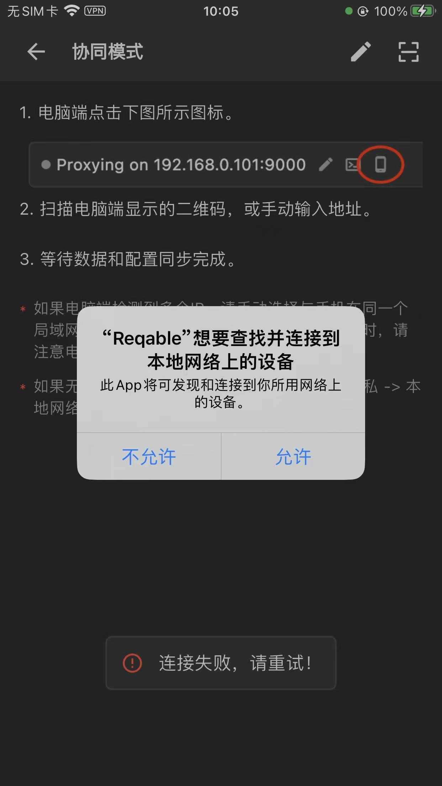
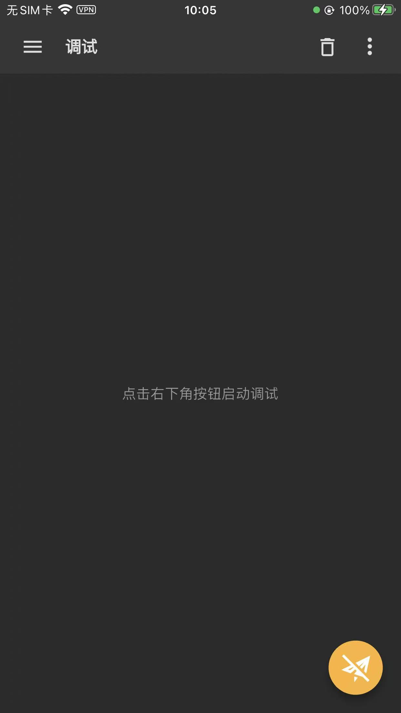
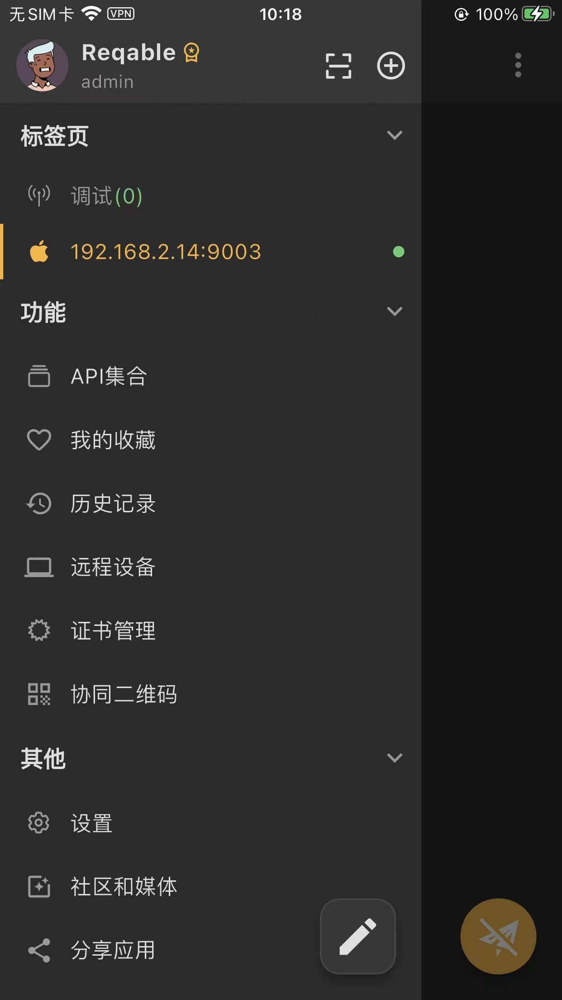
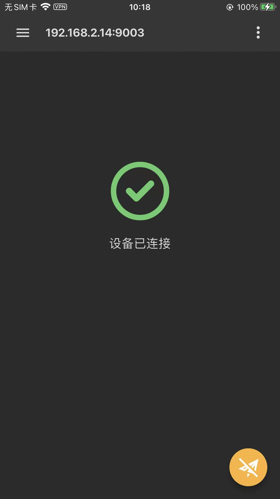

# 协同模式首次扫码经常失败

移动端Reqable的协同模式，首次扫码时

* （1）必然失败 -》因为后续要先去申请摄像头的权限
  * 同意给权限后，才能：再次重新去扫码，才能进入协同模式

此处往往是，点击：允许，但是其实也是：失败了，所以会跳转回默认的模式：本地工作的模式

* （2）（再次扫码成功）进入协同模式后：其实此时已经，由于上次的扫码失败，自动退回到：独立模式=iPhone本机抓包模式了
  * 需要自己额外，点击左上角，自己再次点击带IP地址的那个，去切换到：协同模式

才能进入：协同模式：

