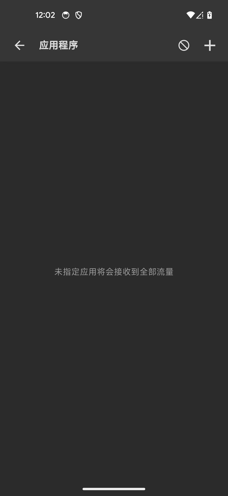
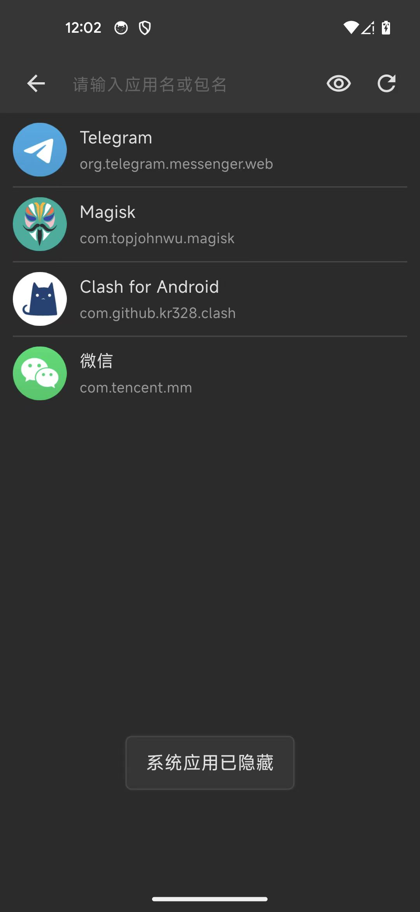
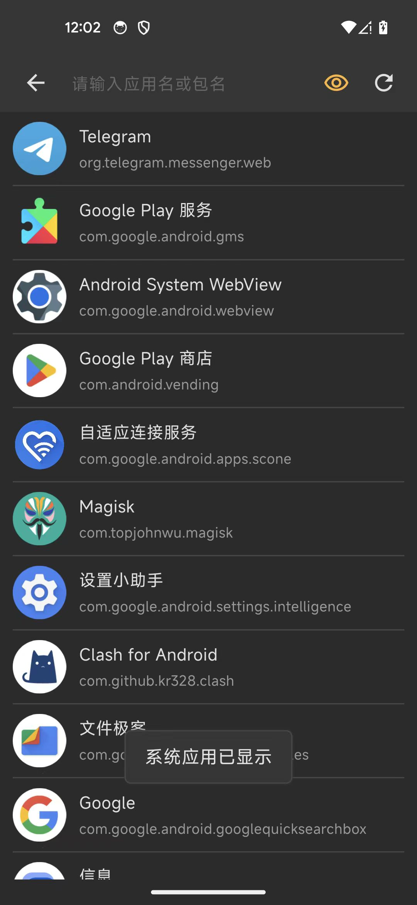
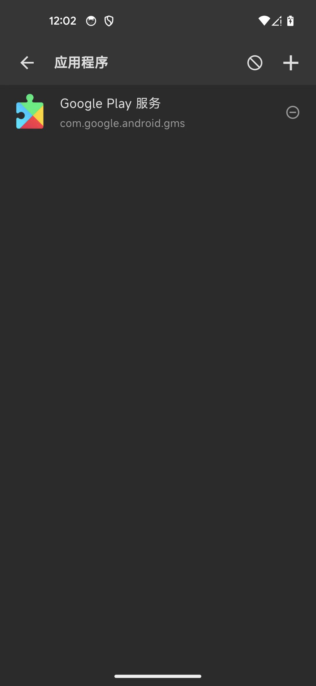
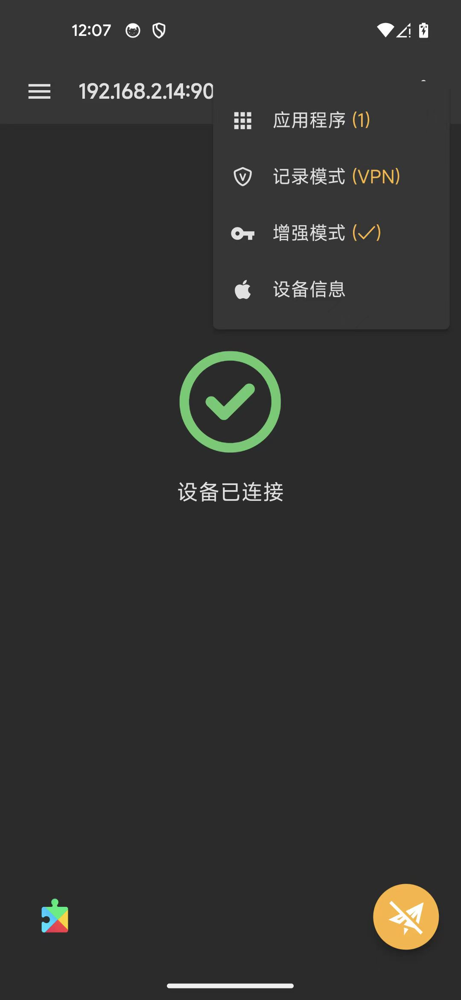
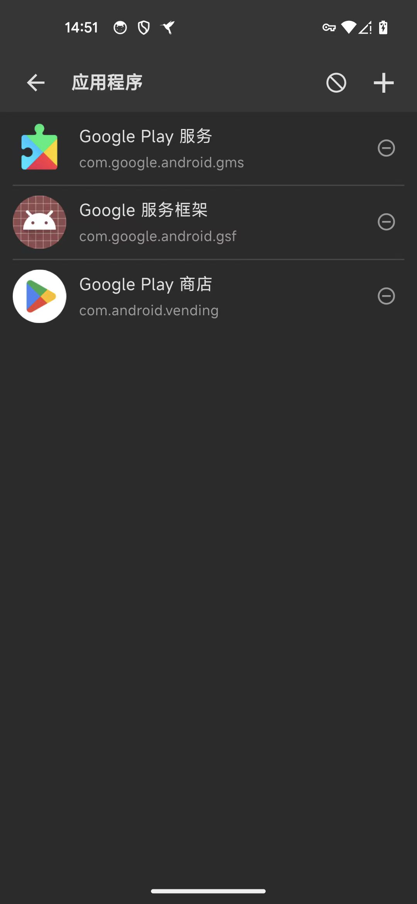
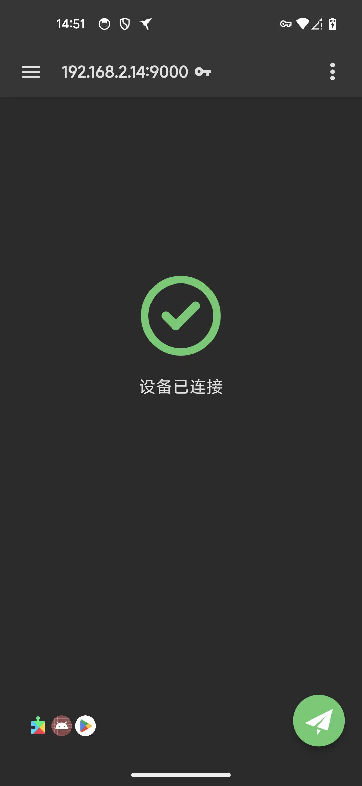
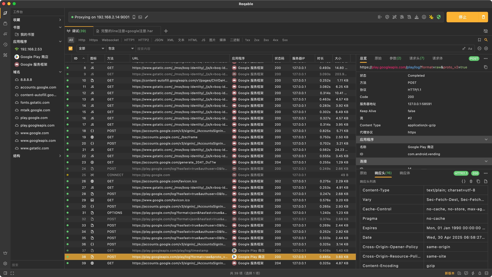
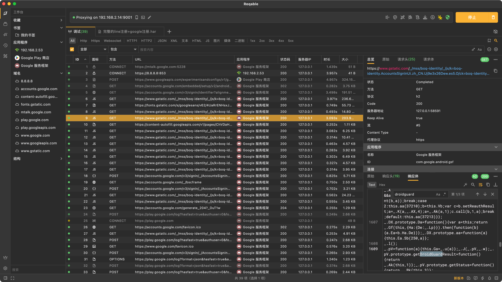

# 过滤特定app

使用Reqable去抓包时，可以指定过滤特定app。

比如Android中Reqable设置好，已开启抓包之前或之后，都可以去设置：

点击右上角的三个点，显示出菜单，其中有个：`应用程序（0）`

点击后，进去app过滤页面：

此处默认没有过滤任何app，点击加号➕去过滤：

此处默认只显示第三方app，没有系统app

此处，去显示系统应用，点击 眼睛👁图标

即可显示全部应用，包括系统应用了

此处点击勾选：

* Google Play服务
  * com.google.android.gms

即可加入此app的过滤了：

回去主页面，更多菜单中就显示：`应用程序（1）`

以及左下角出现被过滤的app的logo图标：

根据需要，也可以加上更多app的过滤：

* Google服务框架
  * com.google.android.gsf
* Google Play商店

Reqable的页面效果：

## 抓包效果

此时，Mac端协同抓包的话，对应只抓取对应此处3个app的流量了：

即可。
