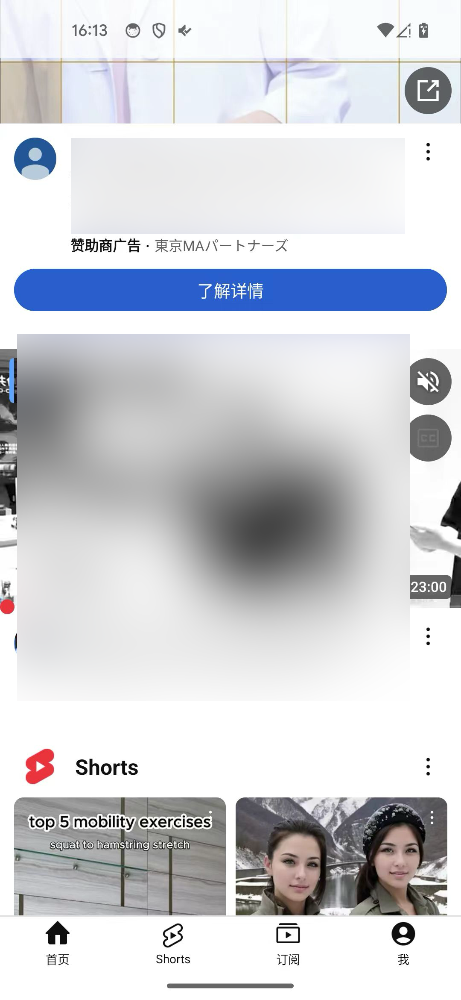
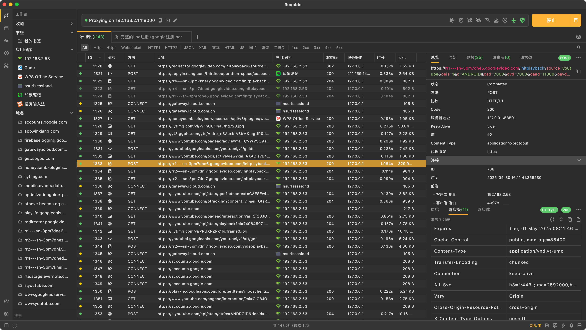
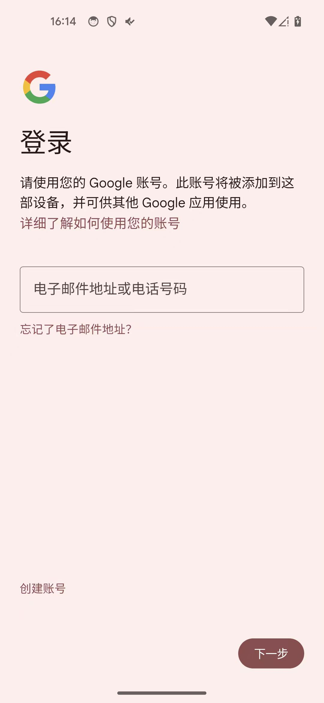
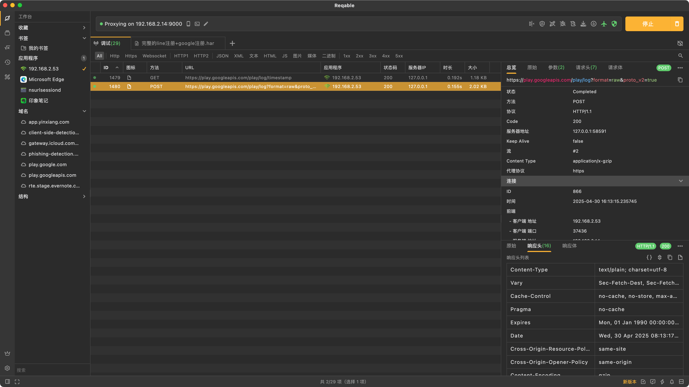
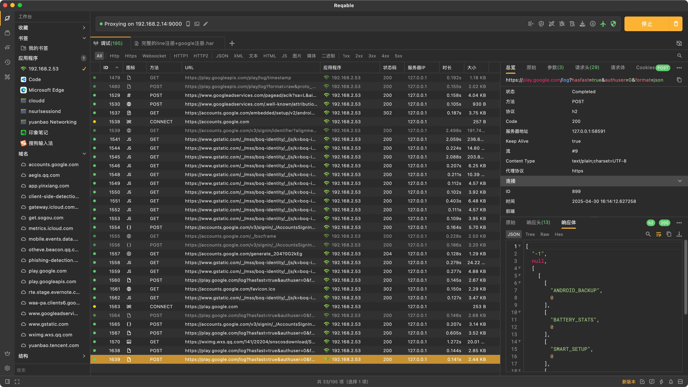
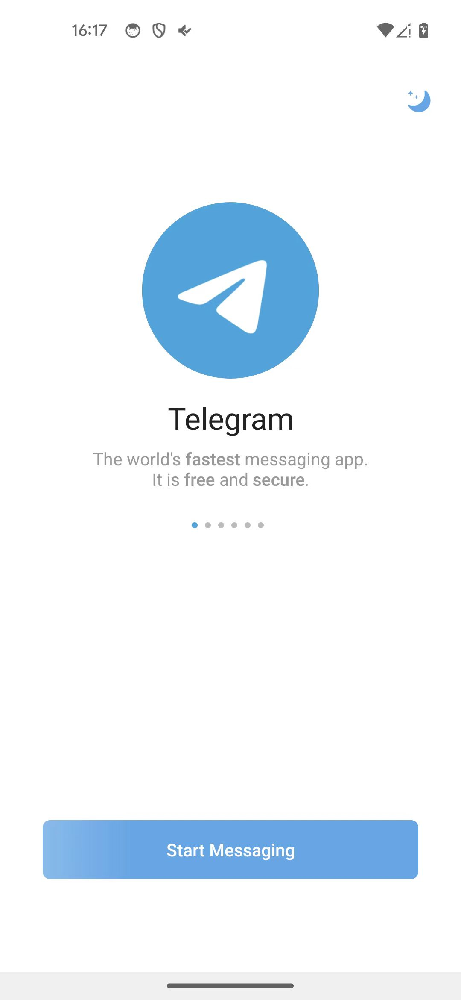
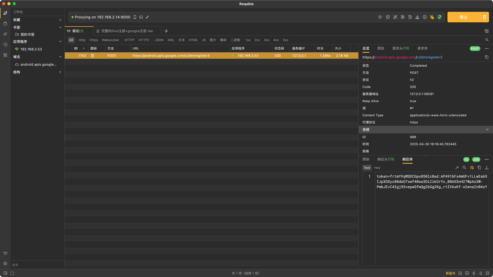
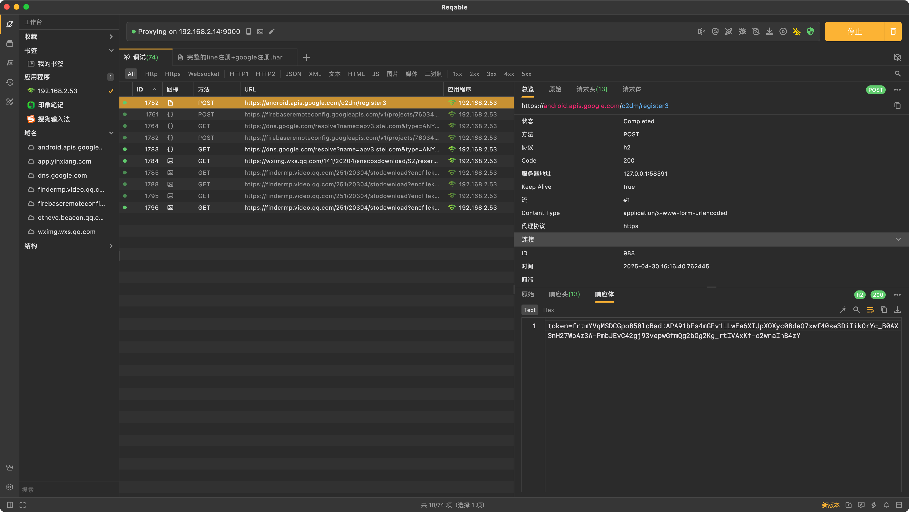

# 二级代理抓包效果

如此，即可实现，在Mac中Reqable中，抓包安卓设备中的网络请求了 == 二级代理后的抓包效果：

效果：安卓端打开Youtube：

然后Mac端Reqable中可以抓包到流量：

以及：安卓端打开Google Play商店，并尝试登录：

Mac中Reqable可以抓到包：

另外，尝试去打开：Telegram：

然后可以触发到=Reqable抓包到，相关请求：

* https://android.apis.google.com/c2dm/register3

