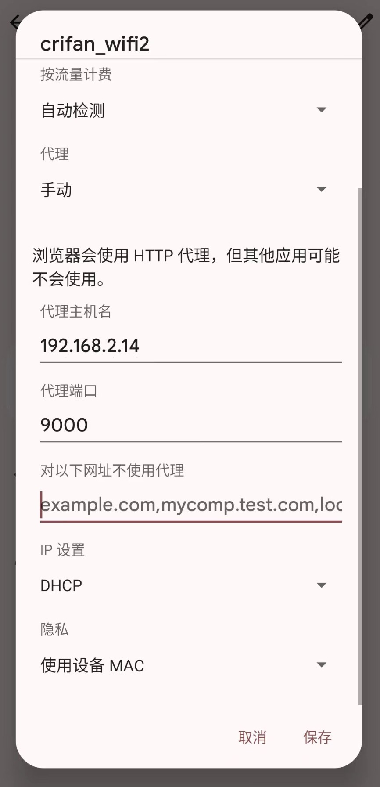
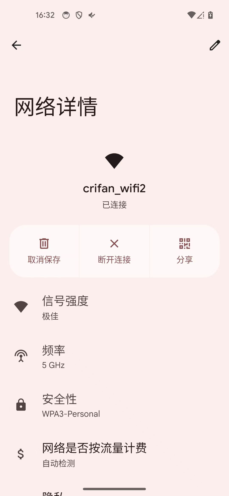
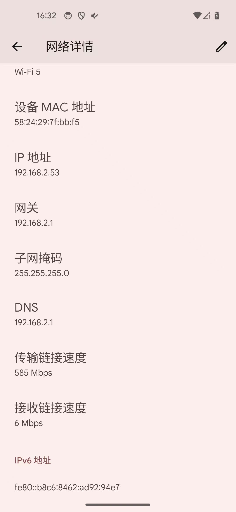

# 如何配置二级代理

概述：

* Mac + Android
  * Android端：WiFi代理，设置为：Mac端Reqable的代理==协同抓包
    * 此处是：`192.168.2.14:9000`
  * Mac端：本地有能翻墙的代理，加上二级代理，且启用后，即可继续用Reqable去正常抓包
    * 且为了支持安卓端的app（Youtube、Google Play商店等）的翻墙访问外网的需求，需要给Mac端Reqable去加上二级代理
      * 二级代理用Mac端的Trojan的代理：`允许局域网访问` + `HTTP代理`是：（Trojan-QT的）`127.0.0.1:58591`

详解：

## Android端

安卓端的WiFi代理：

注：安卓端的WiFi的IP地址是：`192.168.2.53`

## Mac端

对应着：Mac端的Reqable的代理设置

Mac端的Trojan的代理：开启局域网共享 + HTTP代理是：127.0.0.1:58591

Mac端Reqable中添加和开启：二级代理

