# 如何配置二级代理

概述：

* Mac + Android
  * Android端：无需给WiFi加代理
    * 详见：[电脑协同抓包](../../working_mode/cowork/README.md)
  * Mac端：本地有能翻墙的代理，加上二级代理，且启用后，即可继续用Reqable去正常抓包
    * 且为了支持安卓端的app（Youtube、Google Play商店等）的翻墙访问外网的需求，需要给Mac端Reqable去加上二级代理
      * 二级代理用Mac端的Trojan的代理：`允许局域网访问` + `HTTP代理`是：（Trojan-QT的）`127.0.0.1:58591`

详解：

## Mac端

而额外的二级代理方面：

Mac中新建和配置二级代理 （Mac中 二级代理=翻墙=支持访问外网）

具体步骤：代理 -> 二级代理 -> 新建配置 可以创建一个二级代理配置：

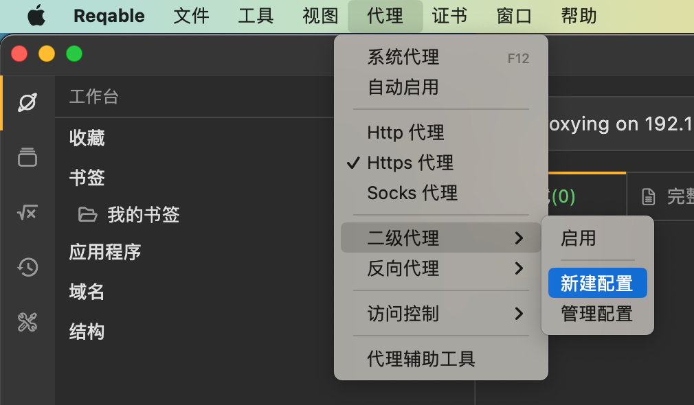

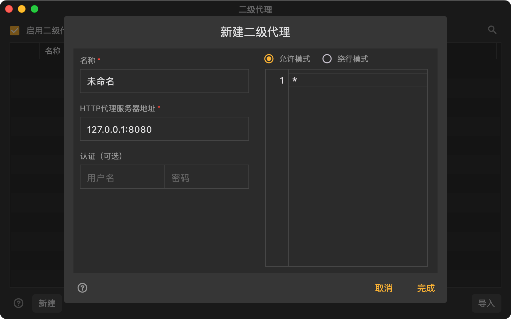

此处所要填写的配置，对应着是：PC端自己的翻墙代理

此处是Mac端的Trojan的代理：开启局域网共享 + HTTP代理是：127.0.0.1:58591

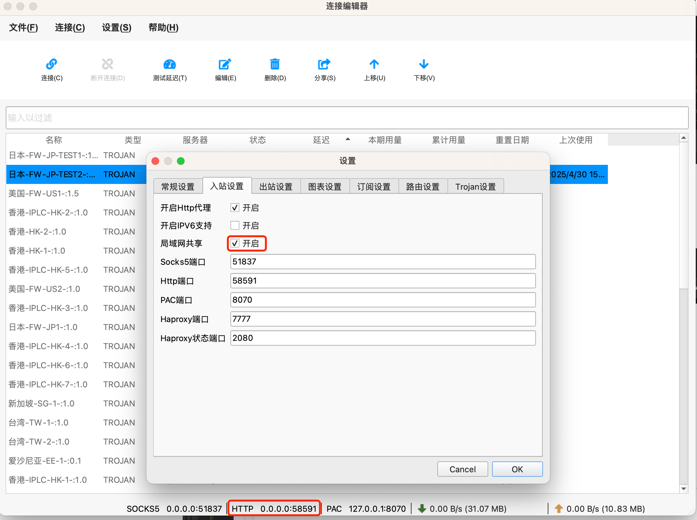

其具体代理配置，可以去Trojan-QT中：

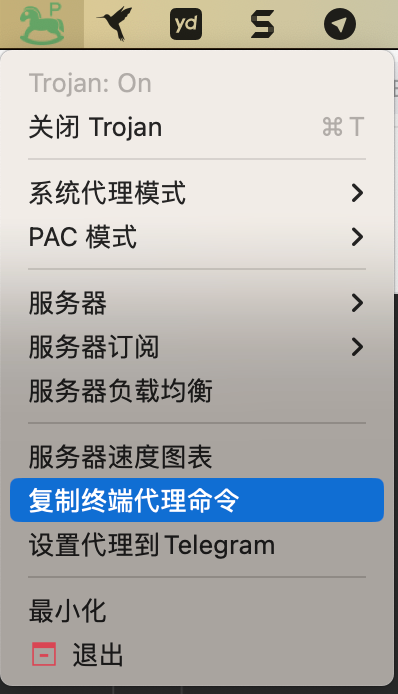

而拷贝出：

```bash
export HTTP_PROXY=http://127.0.0.1:58591; export HTTPS_PROXY=http://127.0.0.1:58591; export ALL_PROXY=socks5://127.0.0.1:51837
```

所以此处是：
* Trojan代理
  * HTTP
    * http://127.0.0.1:58591
  * HTTPS
    * http://127.0.0.1:58591
  * SOCKS5
    * socks5://127.0.0.1:51837

然后再去设置到Mac的Reqable的二级代理中：

* 名称：`MacToTrojan`
* HTTP代理服务器地址：`127.0.0.1:58591`
* 允许模式：`*`

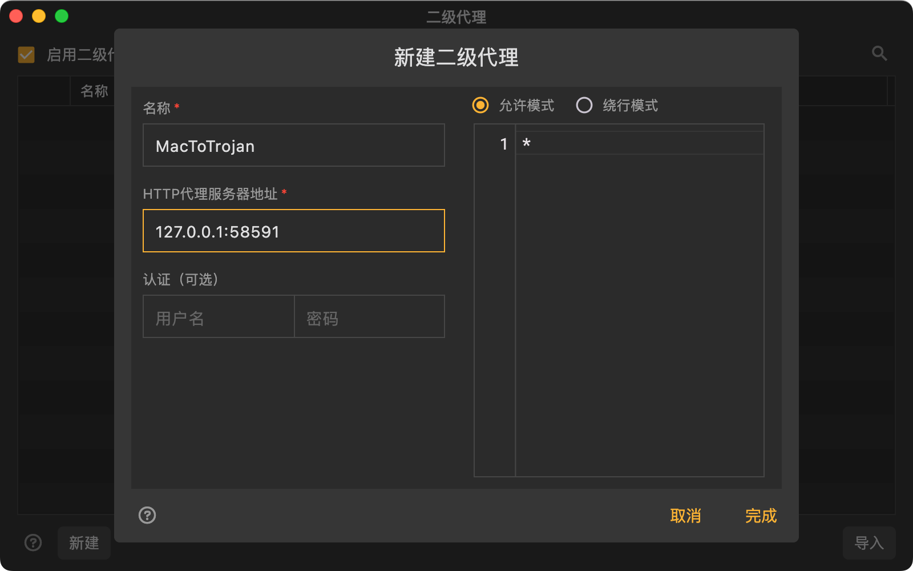

保存后：

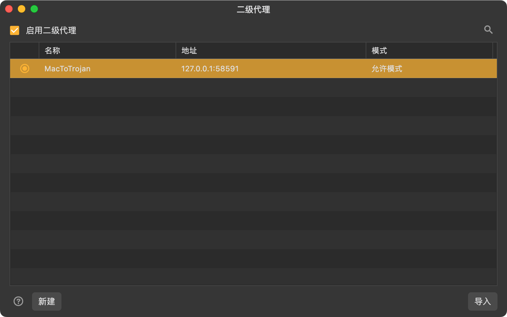

以及，后续要确保的确已开启二级代理：

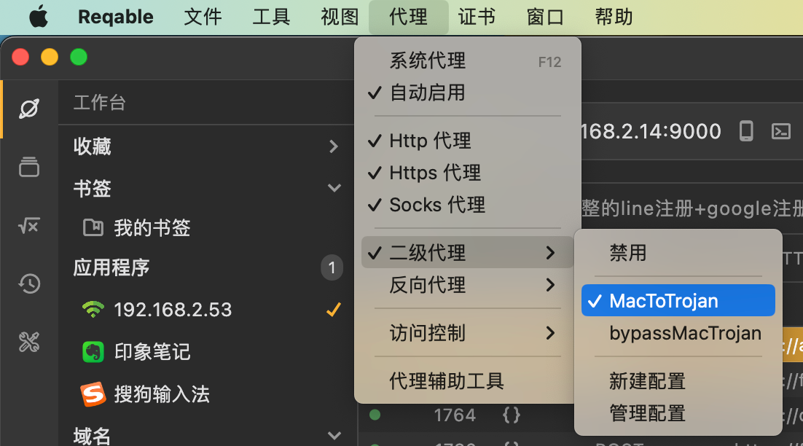

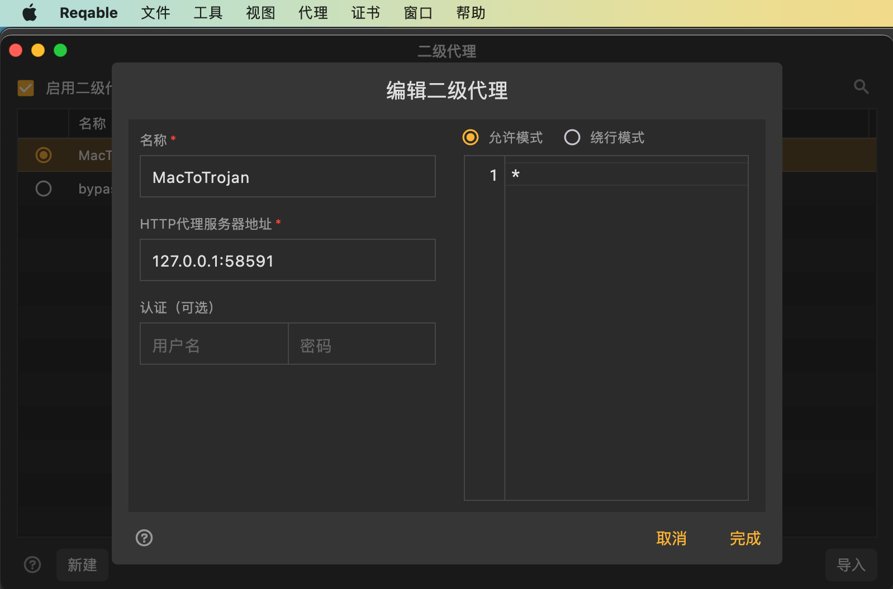

## 使用和效果

对应着：Mac端的Reqable的代理设置

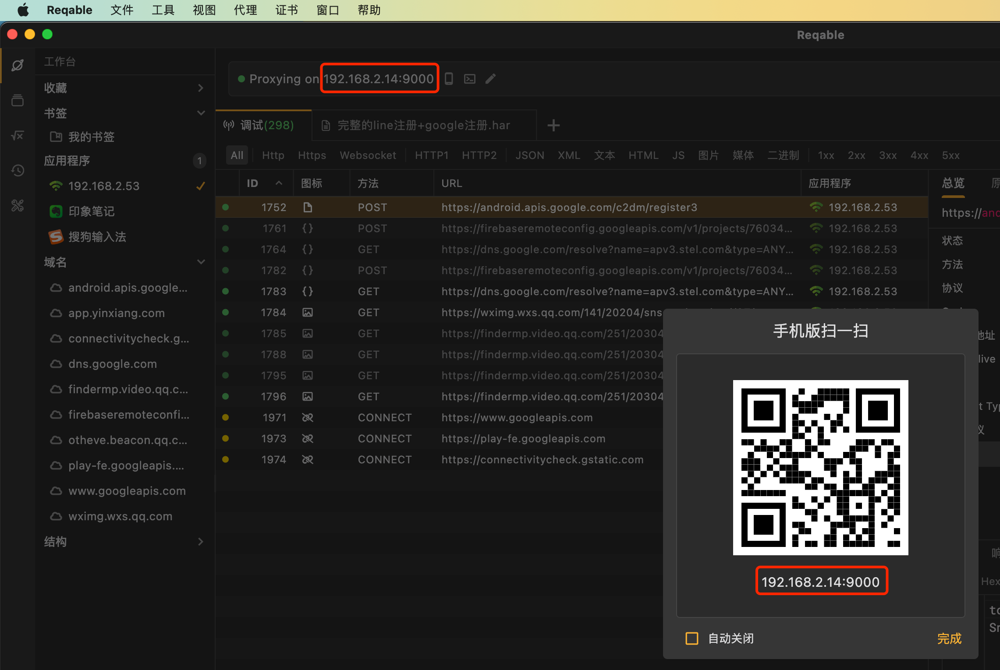

是供移动端去扫描即可。

比如Android端，去扫描添加设备后，连上设备后：

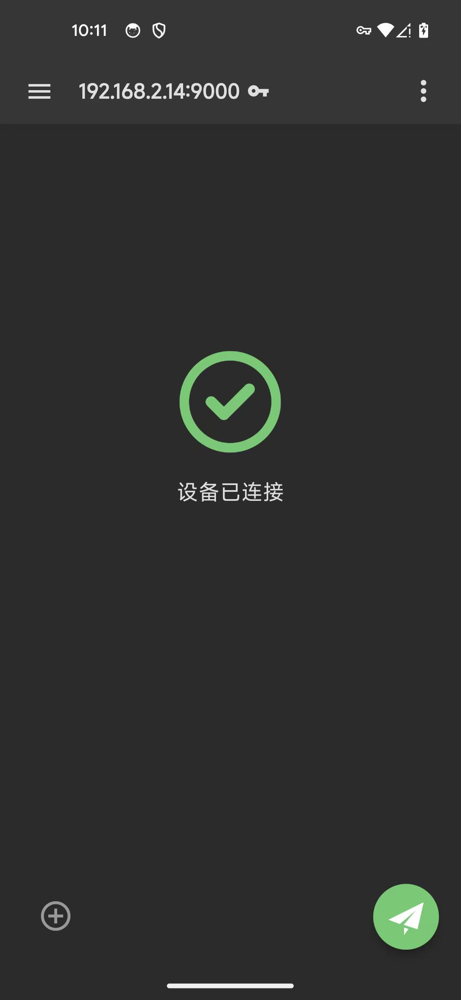

去抓包，效果是：

基本上可以正常抓包

且此处能抓包到：

* gsf=Google 服务框架=com.google.android.gsf
* 微信

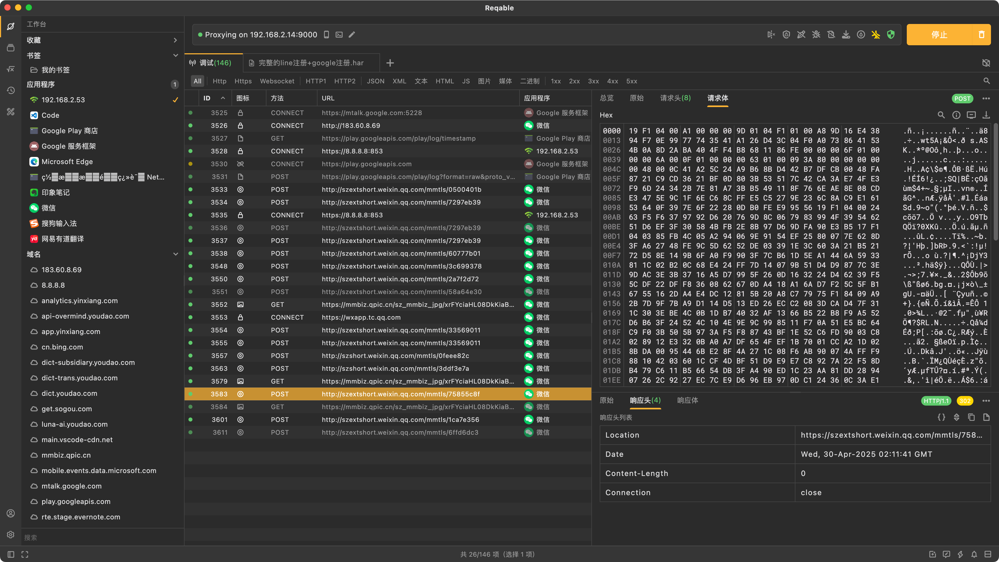
