# Android中初始化配置

## 首次启动

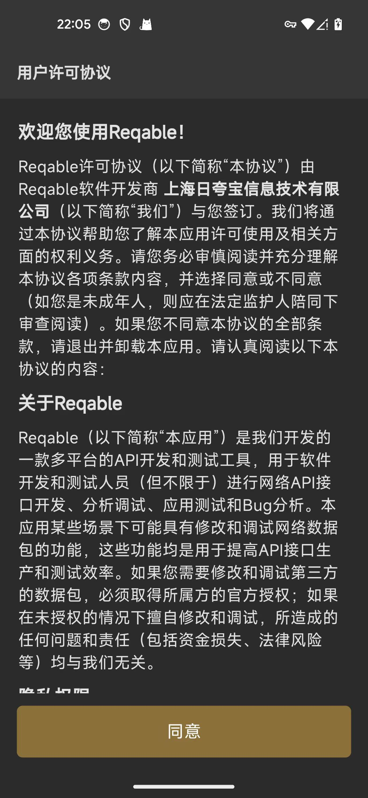

点击同意协议，继续进入：工作模式，默认已选：**协同模式**

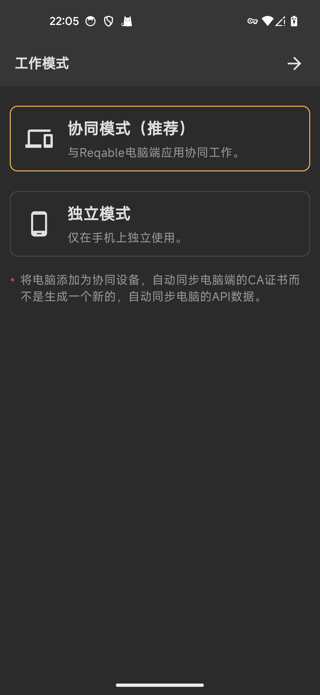

继续进入，协同模式的具体设置：

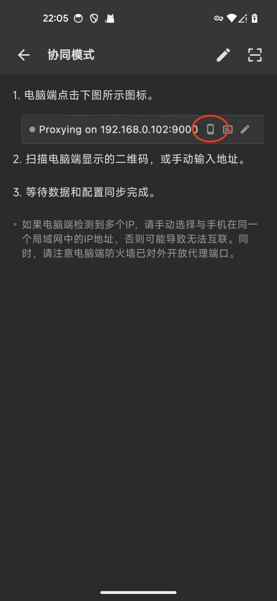

## Android中安装SSL根证书

### Mac中给Android安装SSL根证书

点击Android：

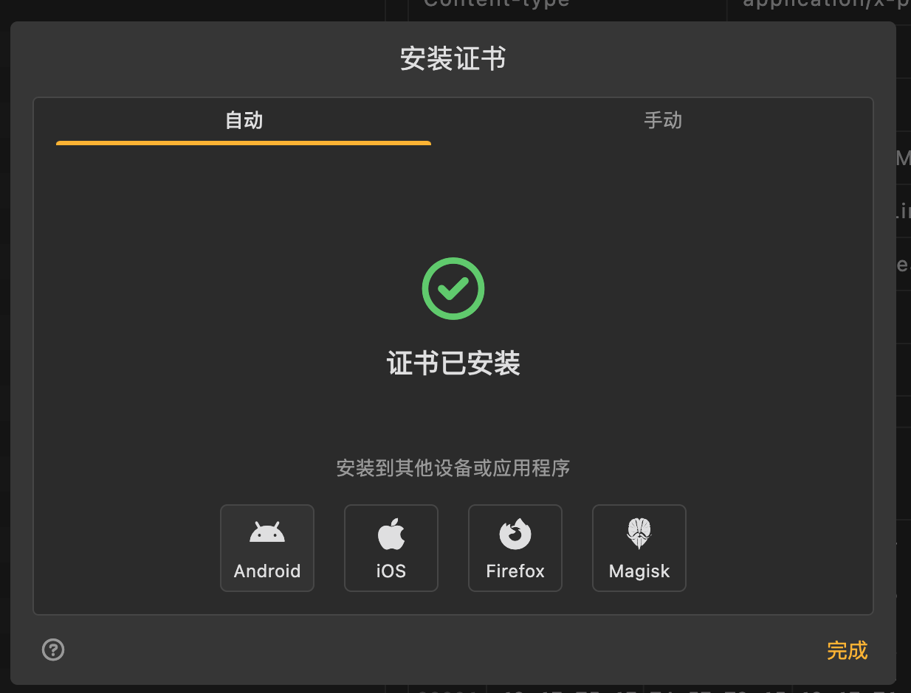

显示弹框：安装证书到Android

此处情况特殊，显示：未安装ADB工具，请先安装！

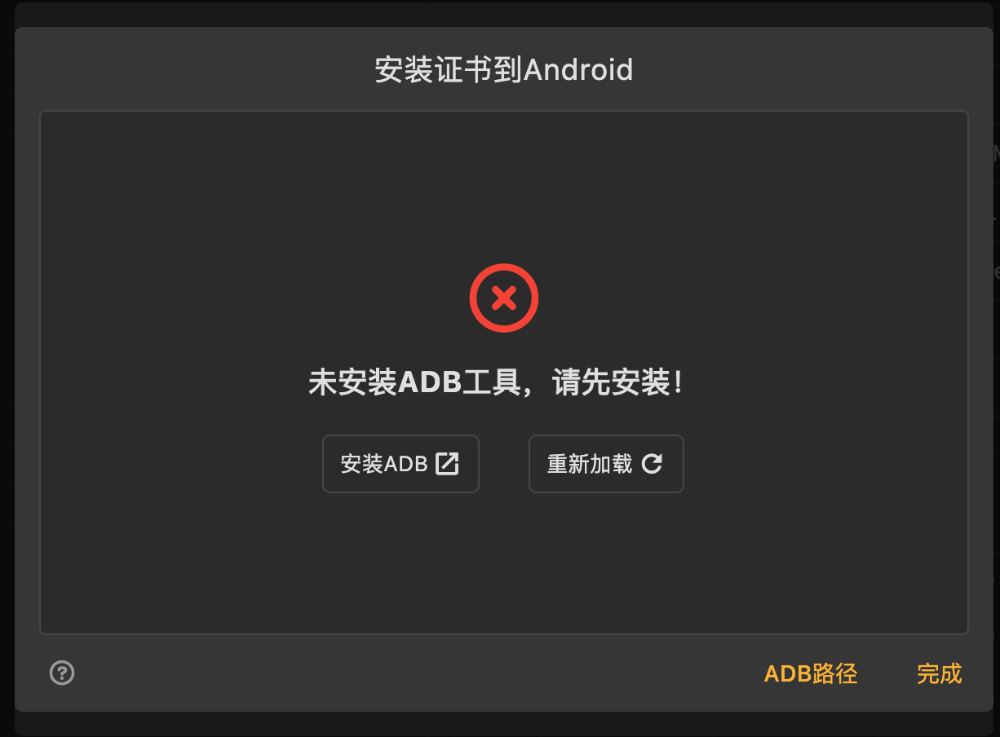

点击 ADB路径 后，出现输入框：

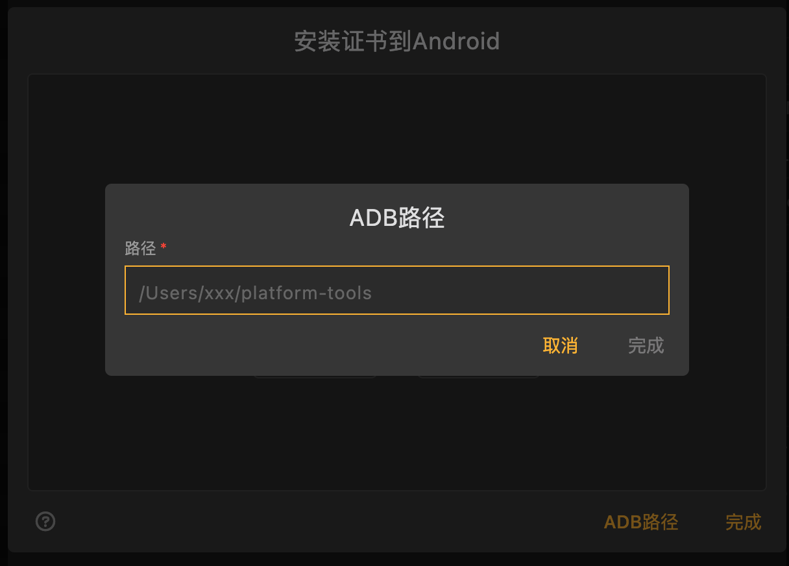

此处先去Mac中，用which，查找出此处adb的路径：

```bash
➜  Android which adb
/Users/crifan/dev/dev_tool/android/AndroidSDK//platform-tools/adb
```

得到路径是：

* `/Users/crifan/dev/dev_tool/android/AndroidSDK//platform-tools/adb`

去填写进入：

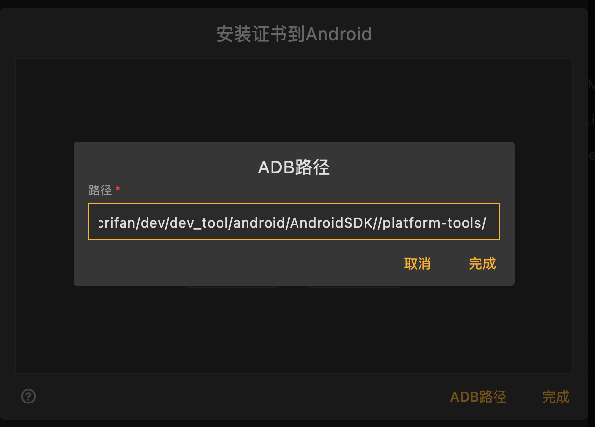

开始把证书安装到Android：

此处显示：系统证书和用户证书，都还没安装

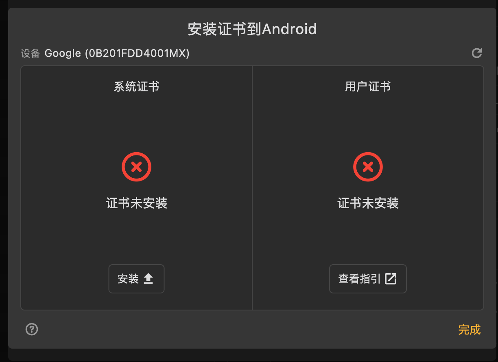

点击 系统证书的 安装，即可安装好系统证书：

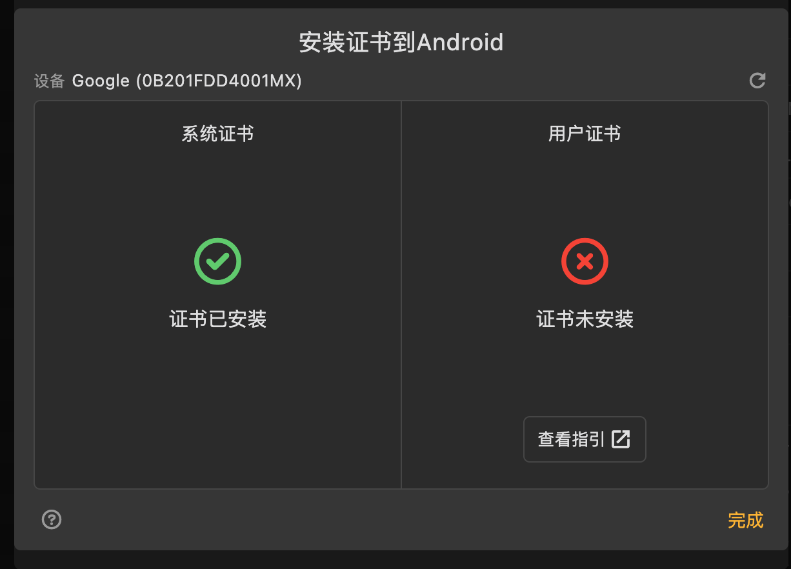

关于用户证书，点击 查看指引，显示具体步骤：

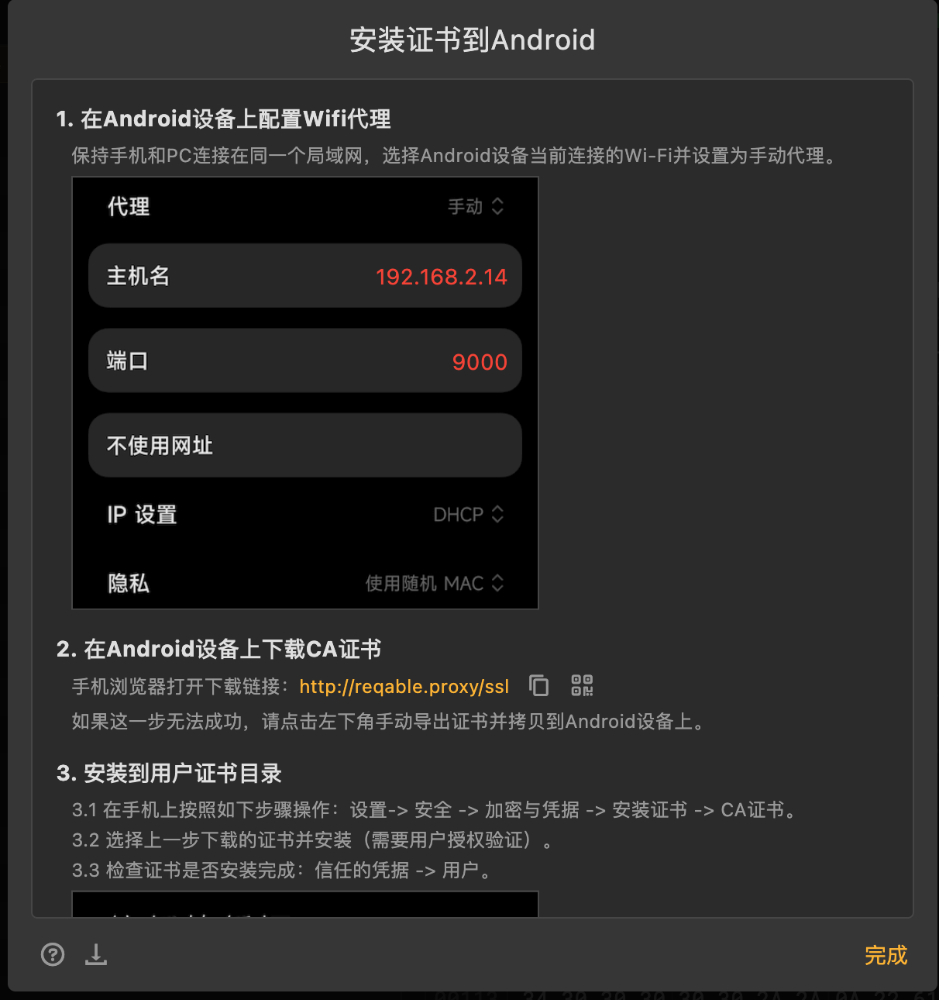

具体步骤是：

1. 在Android设备上配置Wifi代理保持手机和PC连接在同一个局域网，选择Android设备当前连接的Wi-Fi并设置为手动代理。192.168.2.149000
2. 在Android设备上下载CA证书手机浏览器打开下载链接：http://reqable.proxy/ssl如果这一步无法成功，请点击左下角手动导出证书并拷贝到Android设备上。
3. 安装到用户证书目录
  * 3.1 在手机上按照如下步骤操作：设置-> 安全 -> 加密与凭据 -> 安装证书 -> CA证书。
  * 3.2 选择上一步下载的证书并安装（需要用户授权验证）。
  * 3.3 检查证书是否安装完成：信任的凭据 -> 用户。

### Android中查看证书

根据提示安装后，即可看到：

Android设备中的证书：

已安装到系统分区中了 = 可信凭据 的 系统 中有Reqable：

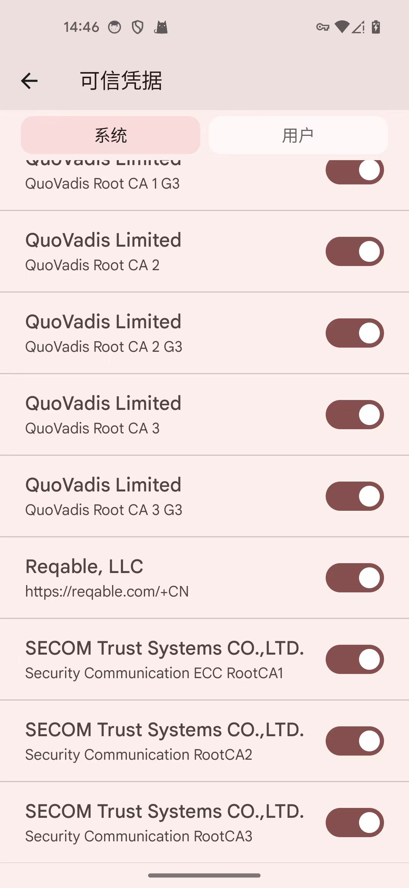

点击可以查看证书详情：

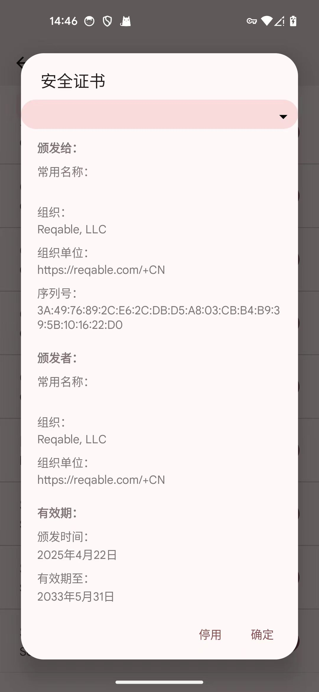

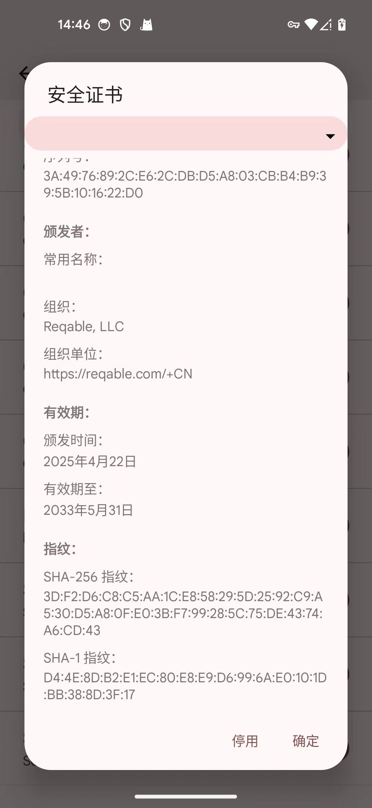

另外，Android中查看到，协同抓包的此处Mac中的设备信息是：

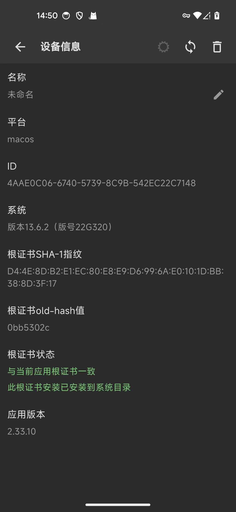

可以看到，显示：

* 根证书状态
  * 与当前应用根证书一致
  * 此根证书安装已安装到系统目录

也是对的。
