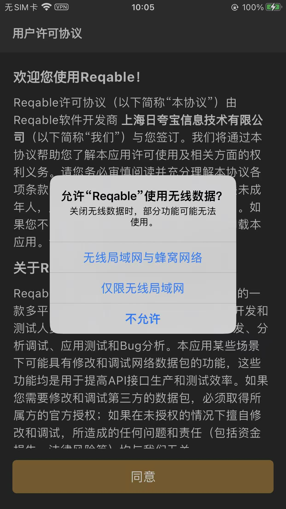
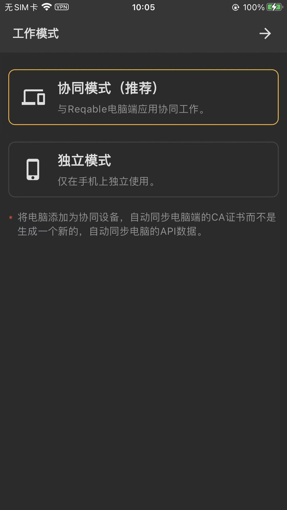
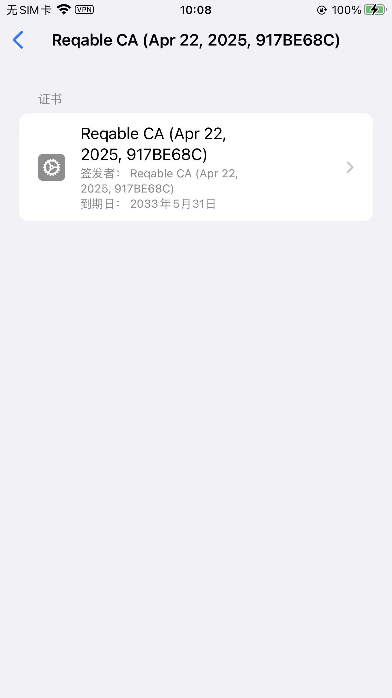
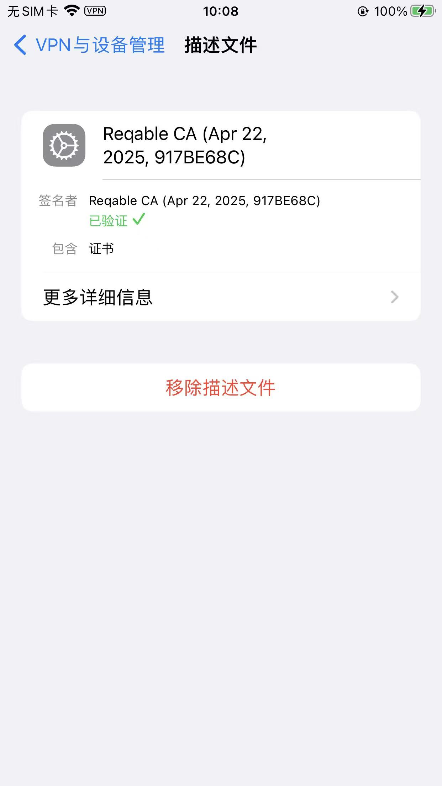
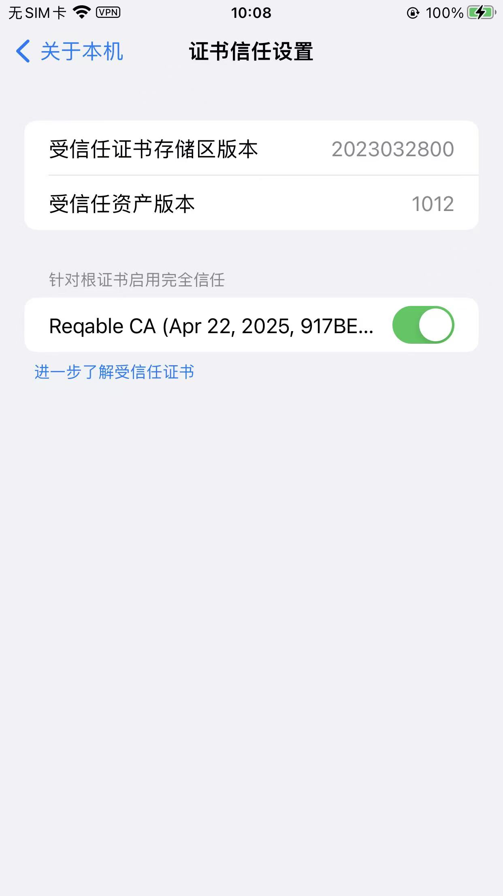
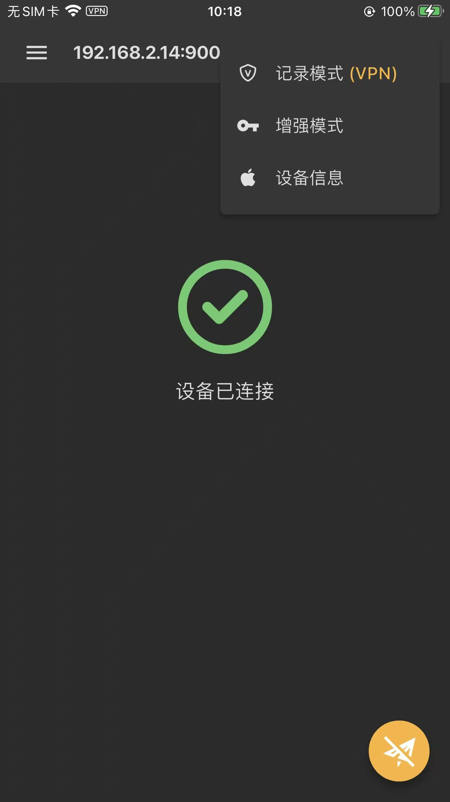
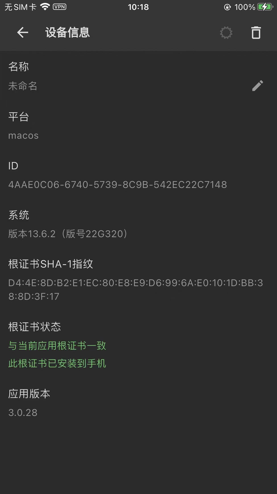

# iPhone中的初始化配置

## 首次打开

然后去打开：

首次启动，会询问你工作模式，默认是：`协同模式（推荐）`==电脑端和移动端协同工作一起抓包 = 移动端抓包+电脑端查看

继续，进入主页

## 安装证书

证书安装并信任：

以及：

通用->关于本机-》证书信任设置，中，也有已信任Reqable的证书：

## 证书设置好后

其他细节：

证书安装和信任成功后：

iPhone中Reqable的协同工作模式下，设备已连接后，去查看设备信息：

可以查看到，协同工作的电脑端，此处是Mac的设备的信息：

可以看到：

* 根证书状态
  * 与当前应用根证书一致
  * 此根证书已安装到手机

就是对的了。
