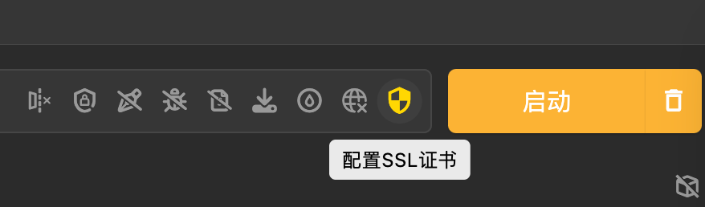
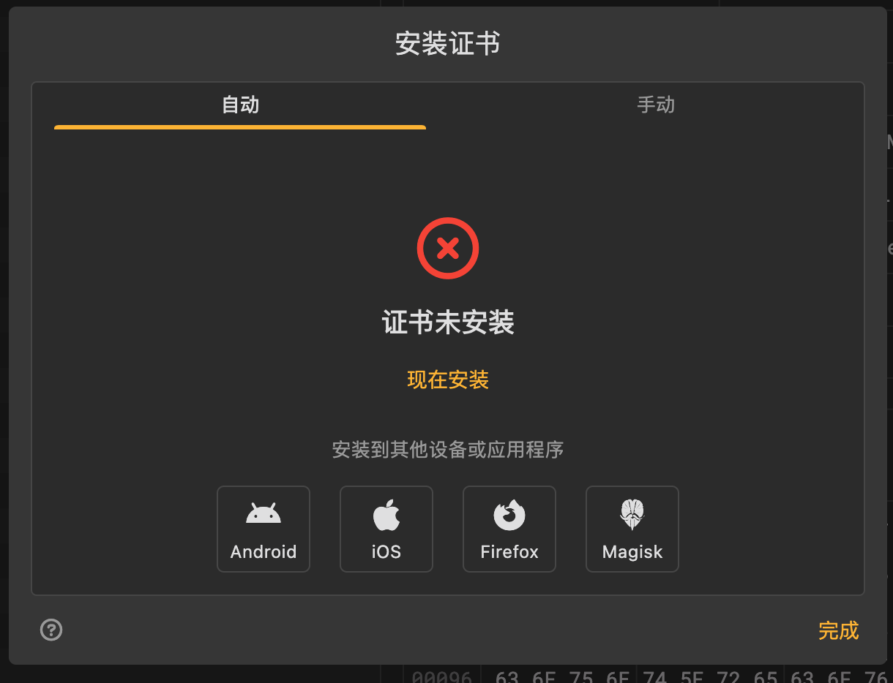
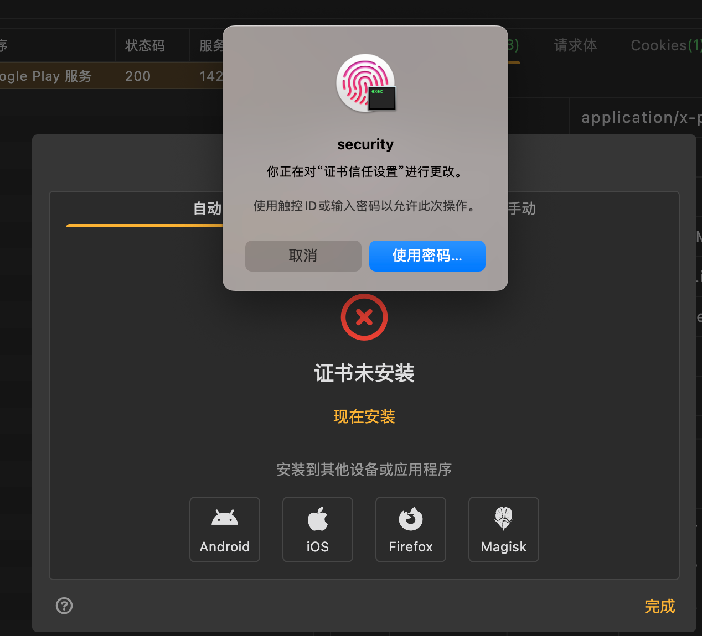
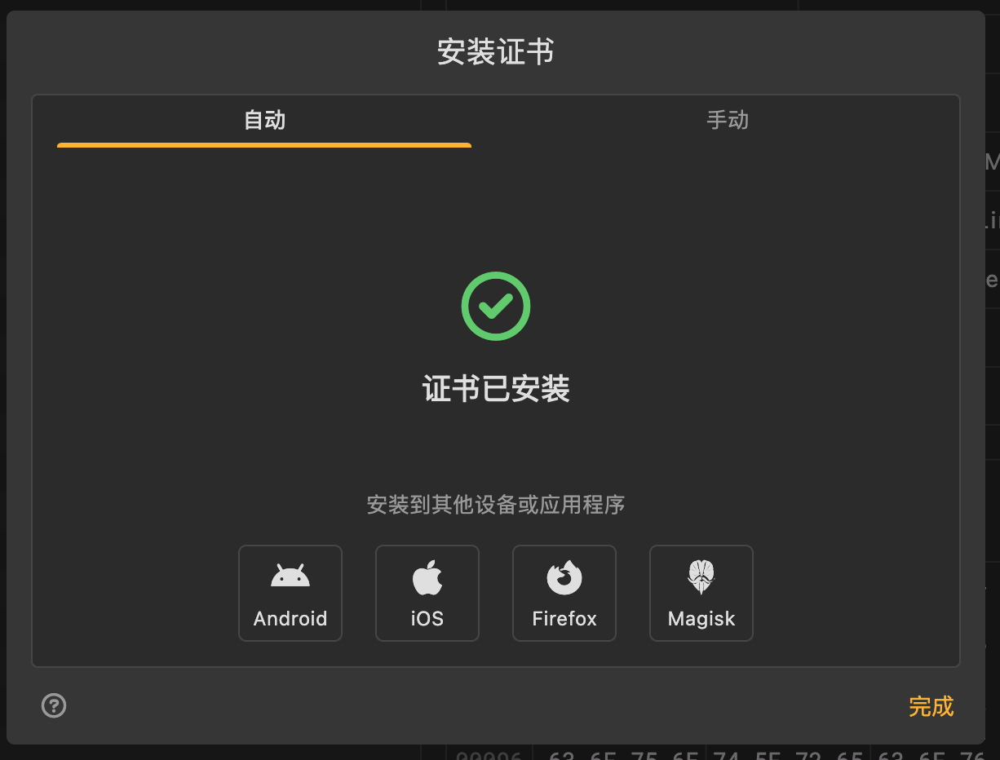
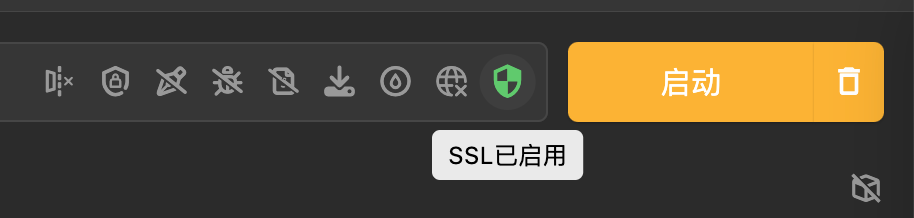

# Mac

## 给Mac中安装Reqable的SSL根证书

参考：[安装证书 | Reqable · API抓包调试 + API测试一站式工具](https://reqable.com/zh-CN/docs/getting-started/installation)

去给Reqable去安装SSL根证书=CA证书：

点击证书，进入：安装证书 的弹框：

点击：现在安装，此处Mac中需要输入密码

即可显示：证书已安装

此处顶部显示：SSL已启用

