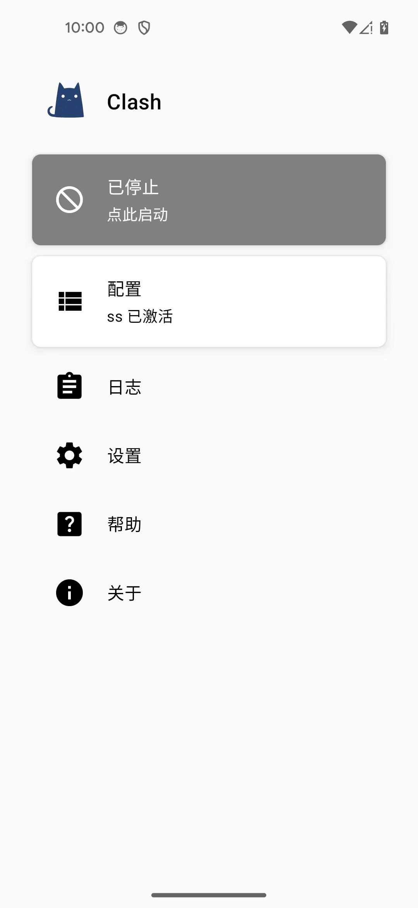
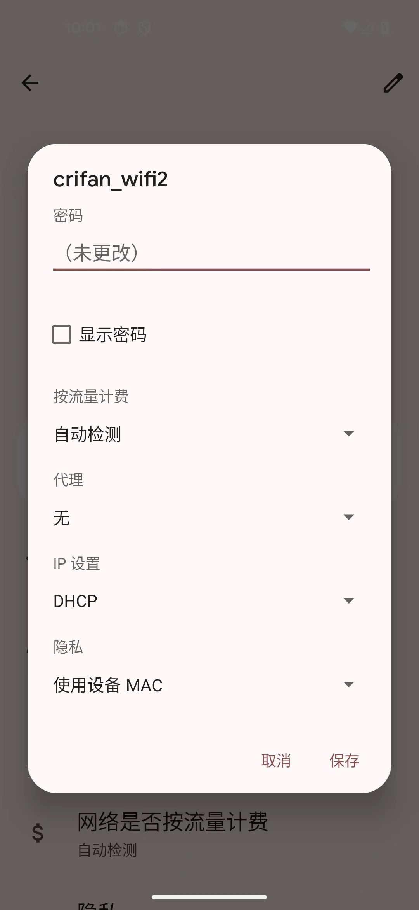

# 电脑协同抓包

此处指的是，Reqable支持，移动端（Android/iOS等），和PC端（Mac/Win等），协同工作，共同配合，一起抓包：

* 移动端本地：使用 协同抓包 模式
* PC端：开启真正的抓包

## 前提

此处，移动端：

* 无需：代理=翻墙
  * 注：根据经验：[抓包和代理软件会冲突](../../experience_summary/capture_conflict_proxy.md)，也无法同时开启代理去翻墙
  * 图
    * Android中关闭Clash代理
      * 
* 无需：给WiFi加代理
  * 图
    * Android中没有给WiFi的IP加代理
      * 
