# Mac中协同抓包

## 开启抓包

Mac端的Reqable：`文件`-》`新建API`：

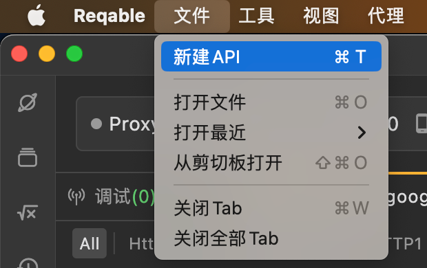

另外先去：鼠标移动到：手机图标上，提示：手机协同配置

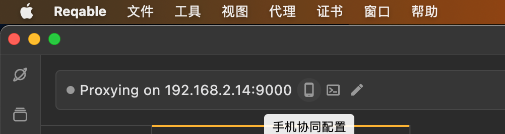

点击后弹框二维码：

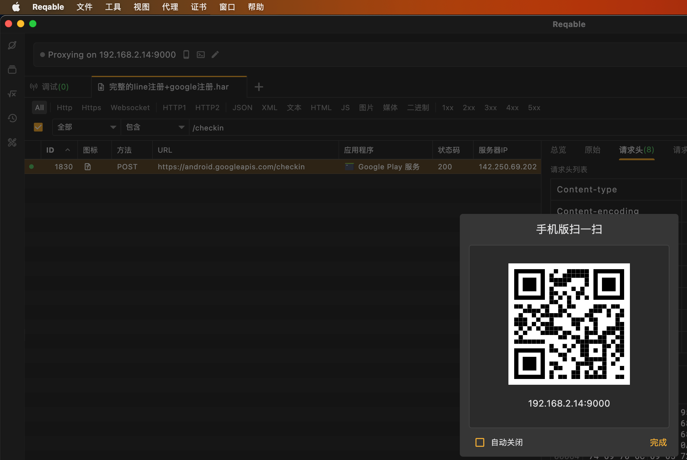

手机端点击右上角的扫描按钮：

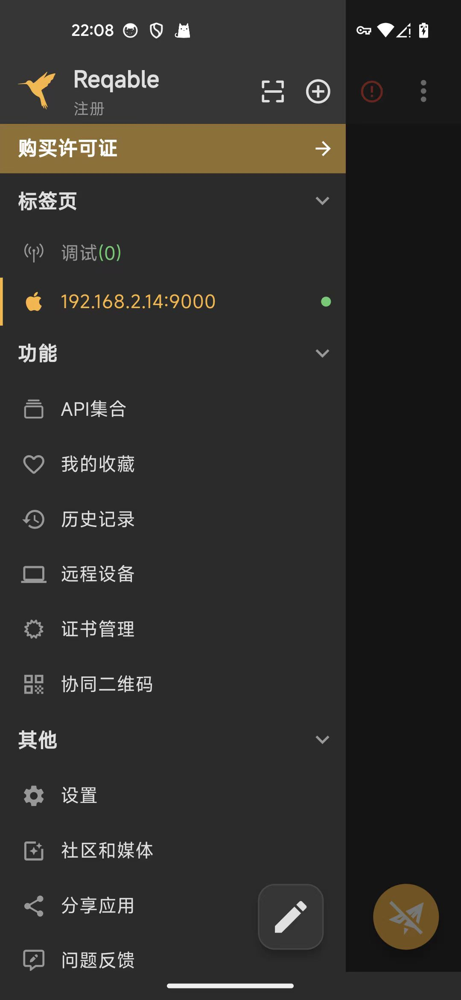

打开扫描页面，扫描上面的二维码，扫描成功后，即可显示： 设备已连接

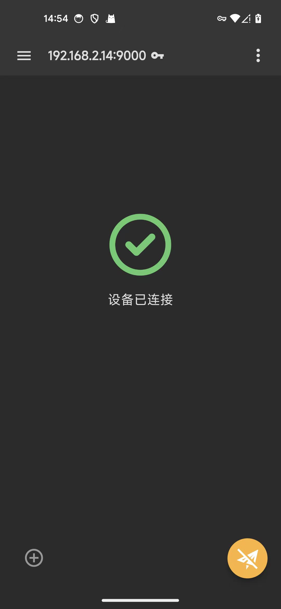

## 效果

### Mac配合Android协同抓包

此处尝试抓包google相关请求：

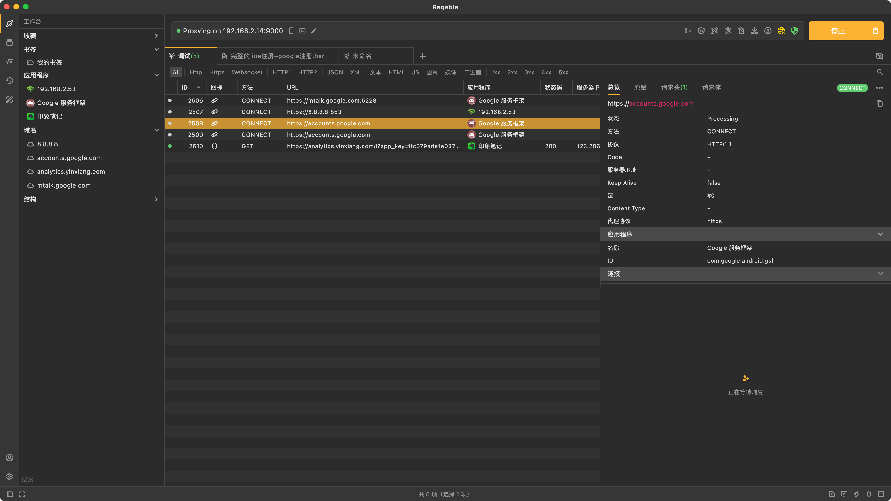

#### 抓包Google的checkin等相关请求

对于google的GMS相关请求：

* https://android.googleapis.com/checkin

```bash
curl -X POST 'https://android.googleapis.com/checkin' -H 'User-Agent: Dalvik/2.1.0 (Linux; U; Android 14; Pixel 5 Build/UP1A.231005.007)' -H 'Connection: Keep-Alive' -H 'Accept-Encoding: gzip' -H 'Content-Type: application/octet-stream' -H 'Content-type: application/x-protobuffer' -H 'Content-encoding: gzip' -H 'Cookie: NID=523=UOv6ns3gYUZiJWO418EaA8XPg8KsWPjaCEIUhA-_wf9C98sGw9_rYxt1wn4oM1yw1Y2iipXUOo8JF8Crr3lYTDBYQiPIBSkTEzjP20eFSvZFGPSLPBS6vRXTg65Lg0FTAmYTfzzf_62rmZitKWICyLHekg2AeqfNeoZYi5VI_BjgoiN53KU' --data-binary @"/Users/crifan/Library/Application Support/com.reqable.macosx/tmp/5837c404-87da-49b8-9c0e-1875bb343e9a" --http1.1
```

对应Reqable抓包效果：

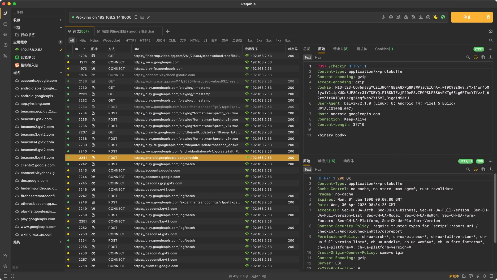

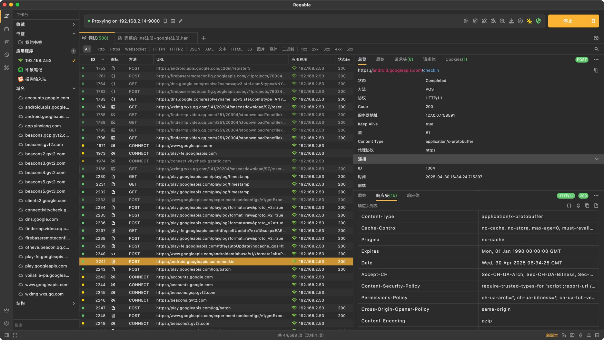

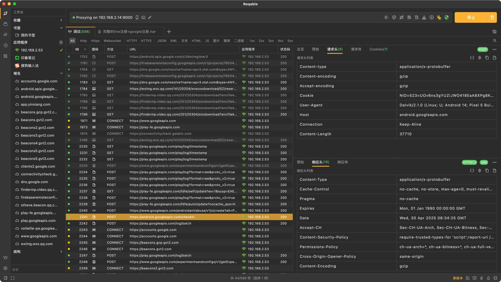

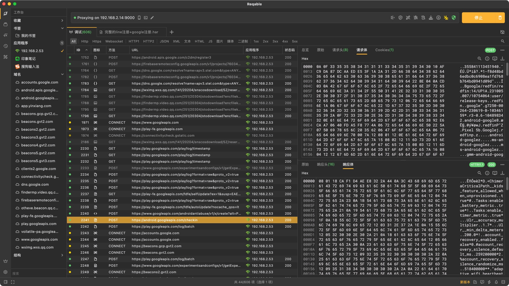

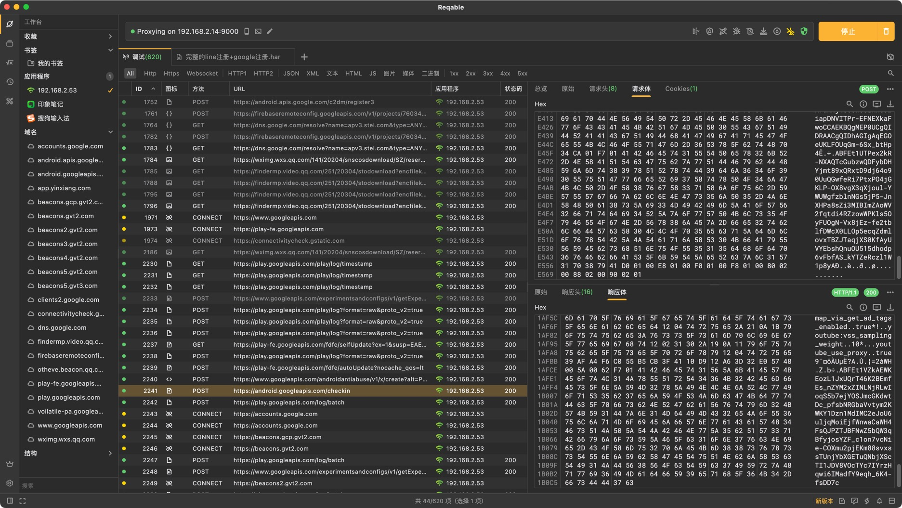

### Mac配合iPhone协同抓包

#### TextNow

继续配合Mac端的Reqable，去给TextNow抓包，就可以了：

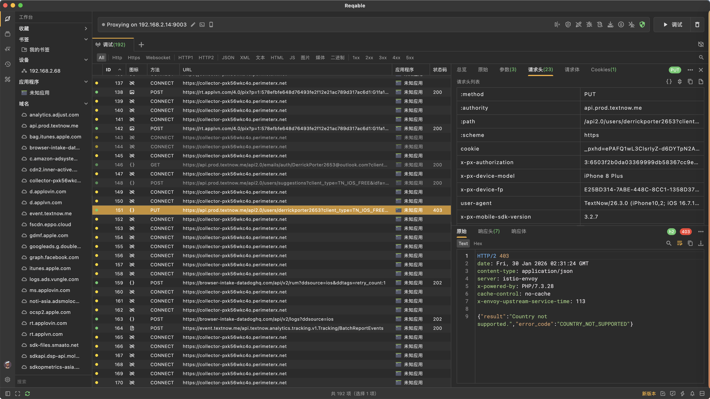

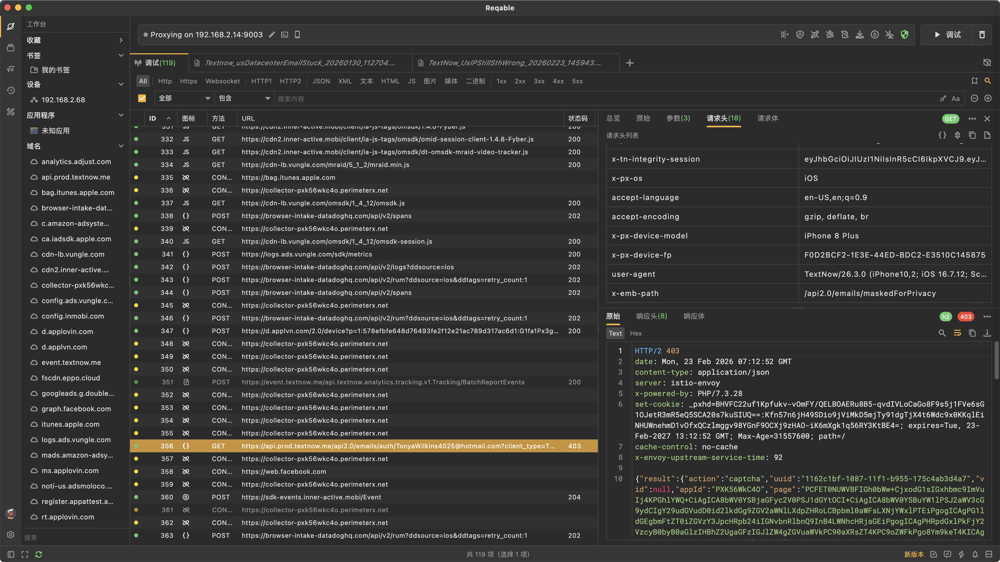

#### Youtube

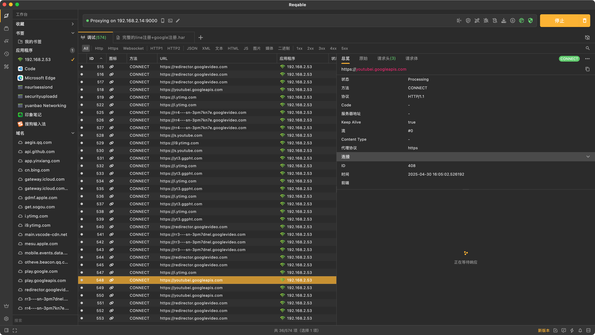

#### Velumbraqua

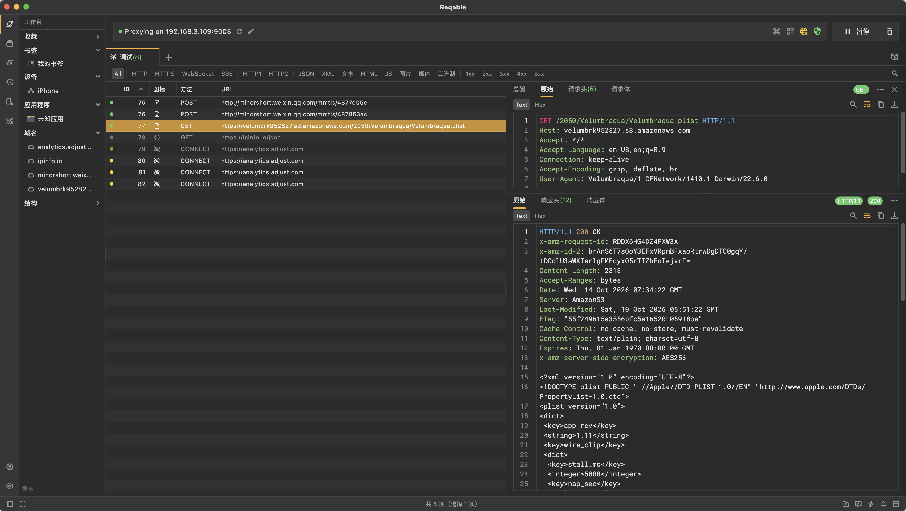

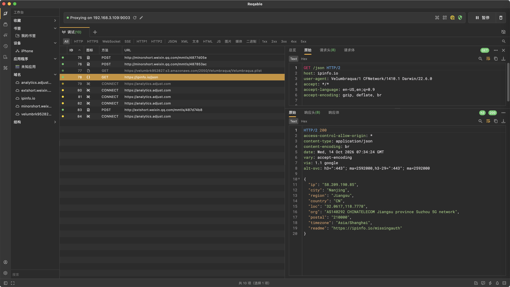
