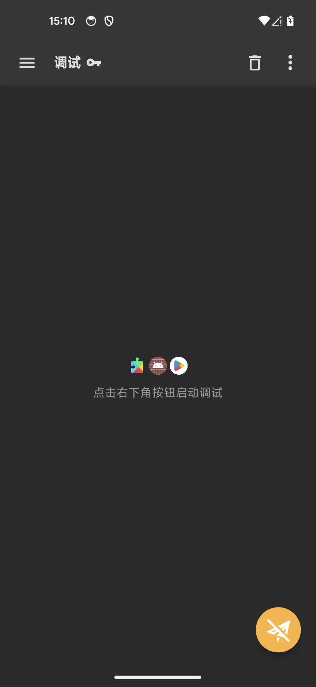
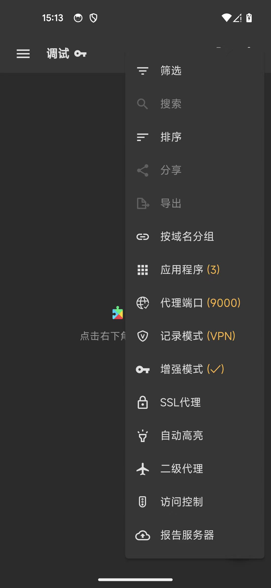
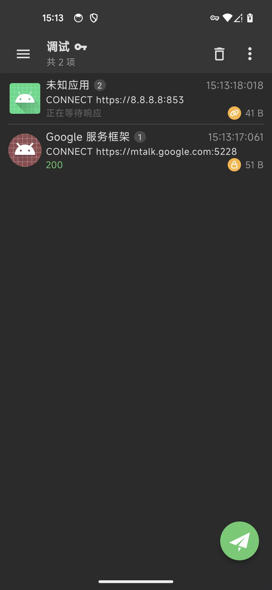
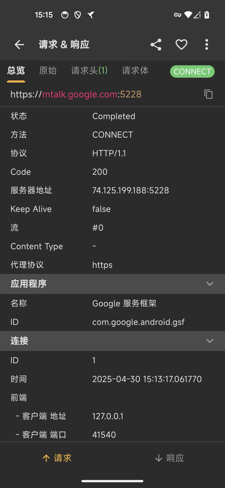
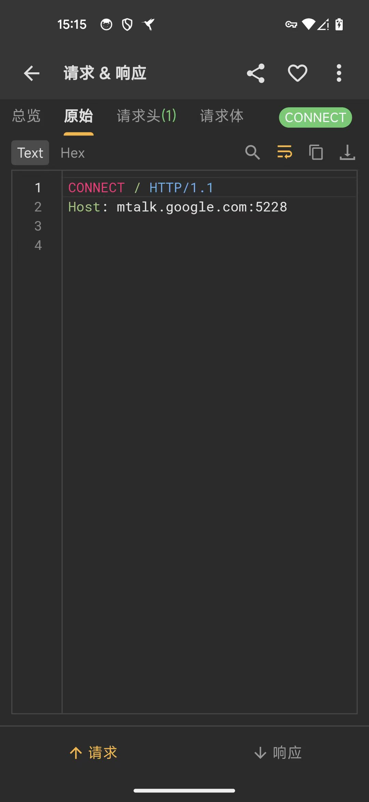
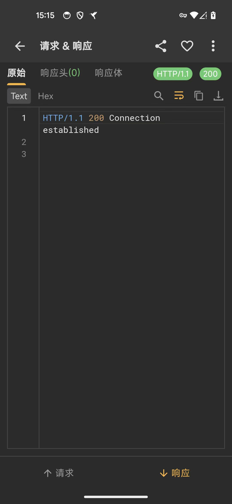
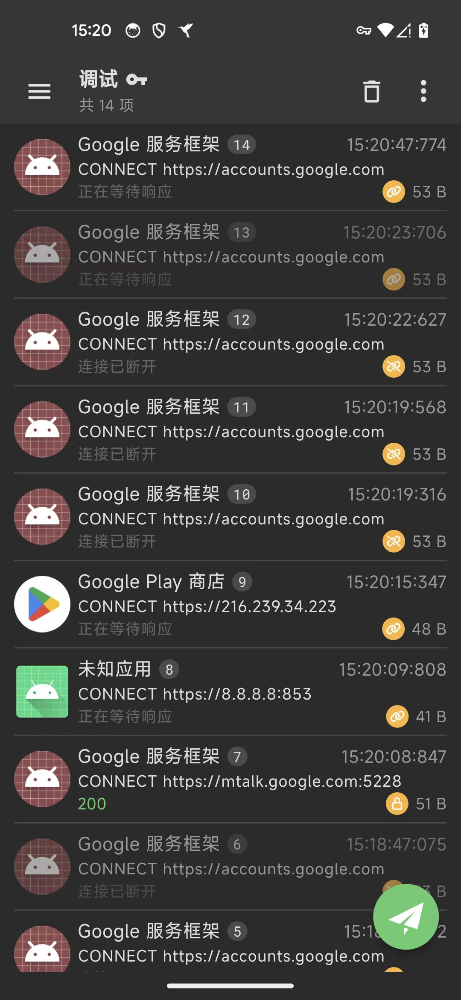
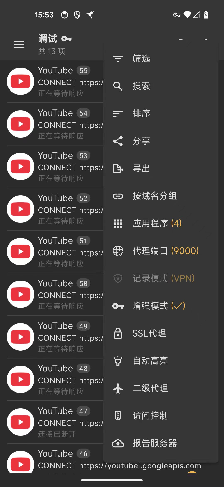
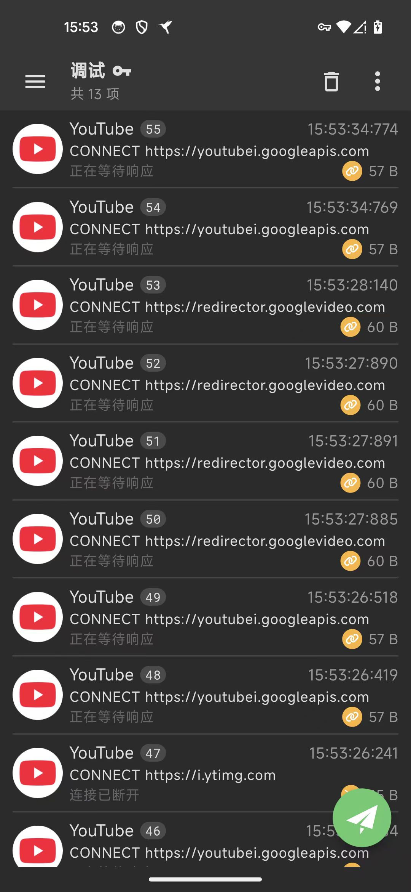
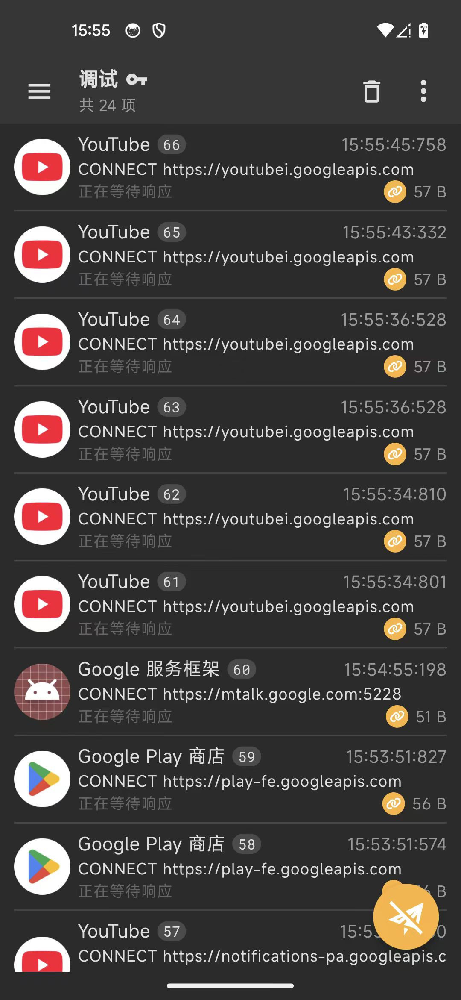

# Android本地抓包

Android本地抓包的话，就是：

抓包页面顶部，显示的内容是：`调试`

且右上角的三个点的按钮，点击后，比 协同抓包 模式时的功能和菜单，多出很多：

以及对应的，抓包出来的内容，直接在：本地=此处，显示出抓包内容（的列表）：

对应的，点击进入后，可以查看本地的抓包的详情：

## 其他抓包效果

### Youtube

Youtube的app页面：

对应抓包：

