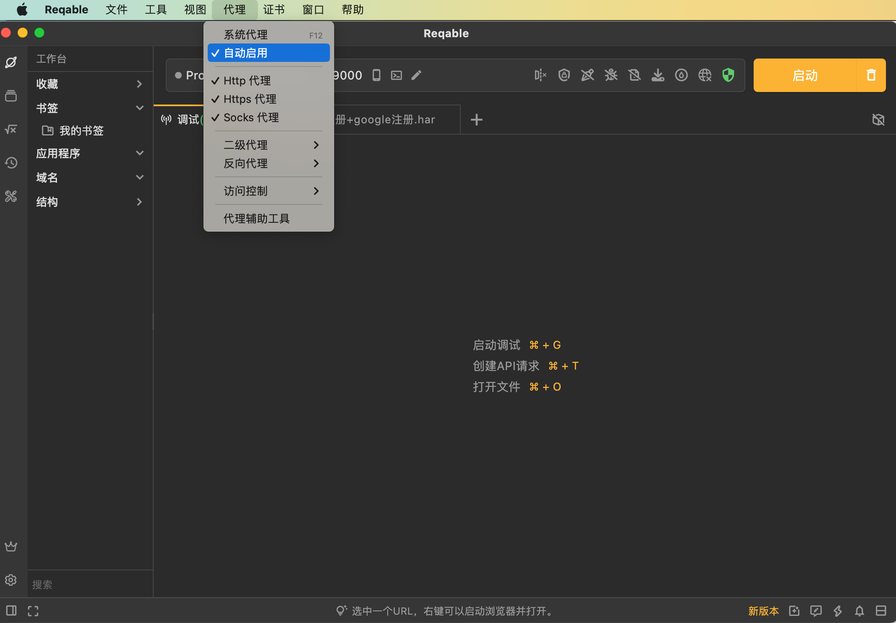

# 电脑开启代理

此处本身Reqable是抓包的工具，但是本身：也支持额外的本地代理

比如：

`代理`->`自动启动`

就表示：此处（Mac/Win等）PC电脑端，就开启了一个：（http等）的代理

典型的地址是：

* http://127.0.0.1:9000
  * 也可以写成：http://{YOUR_PC_IP}:9000
    * 举例，此处Mac的IP是：`192.168.3.137`，就是：http://192.168.3.137:9000
  * 端口号：9000
    * 是本地默认的端口号，你也可以根据需要自己改动
