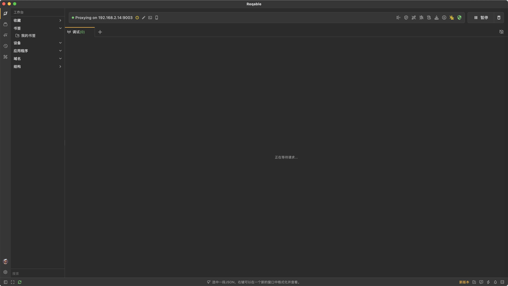
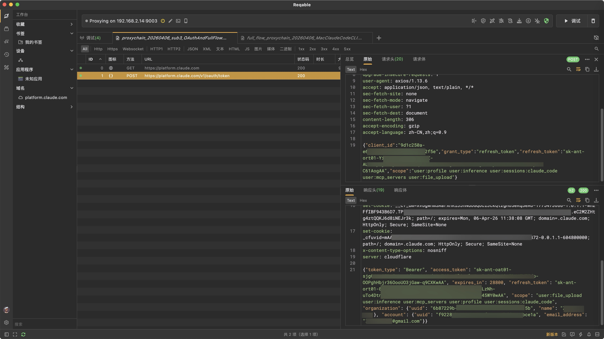
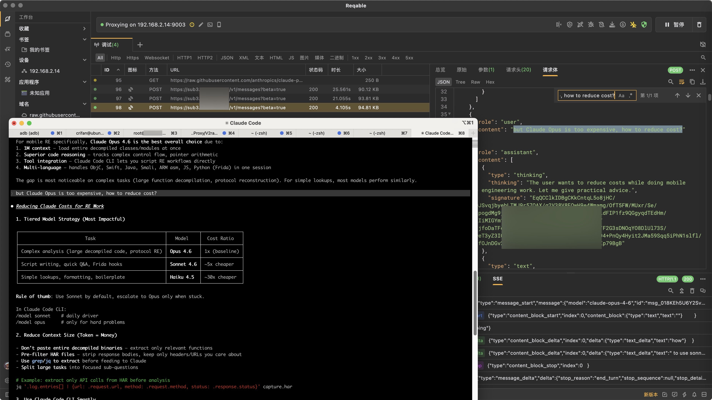
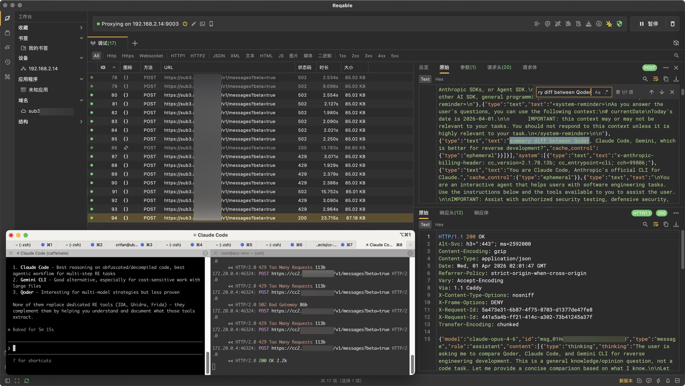

# 电脑开启代理

此处本身Reqable是抓包的工具，但是本身：也支持额外的本地代理

比如：

* `代理`->`http代理`、`https代理`、`Socks代理`：开启对应的http、https、socks的代理
* `代理`->`自动启动`：Reqable启动时，就开启对应代理


就表示：此处（Mac/Win等）PC电脑端，就开启了对应（http、https、socks）的代理

典型的地址是：

* HTTP代理
  * `http://127.0.0.1:9000`
    * 也可以写成：`http://{YOUR_PC_IP}:9000`
      * 举例，此处Mac的IP是：`192.168.3.137`，就是：`http://192.168.3.137:9000`
    * 端口号：`9000`
      * 是本地默认的端口号，你也可以根据需要自己改动，比如：`9003`等

## 用法举例

### Mac中链式代理抓包Claude

之前某次，想要实现链式代理，去抓包Claude相关流量，对应的架构是：

* 完整链式代理抓包架构

```bash 
┌─────────────────────────────────────────────────────────────────────────────────────┐
│                                                                                     │
│  ┌─────────────┐      ┌──────────────┐      ┌───────────────────┐      ┌──────────┐ │
│  │ Claude Code │ ①   │              │  ②   │                   │  ③  │  Claude  │ │
│  │ CLI (Mac)   │────→ │  Sub2API     │────→ │  MITM Proxy       │────→ │  Server  │ │
│  │             │      │  (Docker)    │      │  (sub3 宿主机)     │      │(Official)│ │
│  └─────────────┘      └──────────────┘      └───────────────────┘      └──────────┘ │
│       │                     │                     │         │                       │
│       │ Reqable             │ HTTP Proxy          │ upstream│                       │
│       │ (Mac:9003)          │ 172.17.0.1:8888     │ proxy   │                       │
│       │                     │                     │         ▼                       │
│       │                     │                     │  ┌──────────────────┐           │
│       │                     │                     │  │ webshare-        │           │
│       │                     │                     └─→│ yyyyyyyy-zz      │──→ Claude │
│       │                     │                        │ (IP Proxy)       │   Server  │
│       │                     │                        └──────────────────┘           │
│       ▼                     ▼                                                       │
│   抓包①                  抓包②                                                      │
│   Mac侧流量              服务器侧流量                                                  │
│   (CLI→Sub2API)          (Sub2API→Claude)                                           │
│                                                                                     │
└─────────────────────────────────────────────────────────────────────────────────────┘
```

其中的：

* sub3服务器链式代理架构

```bash
┌──────────────────────────────────────────────────────────────────┐
│  sub3 Host                                                       │
│                                                                  │
│  ┌─────────────────────────────────┐                             │
│  │ mitmproxy (宿主机)               │                             │
│  │ 监听: 0.0.0.0:8888               │                             │
│  │ 模式: upstream proxy             │                             │
│  │                                 │                             │
│  │ --mode upstream:http://         │     ┌────────────────────┐  │
│  │    PROXY_HOST:PROXY_PORT ────────────→│ webshare-yyyyyyy-zz│  │
│  │ --set upstream_auth=            │     │ (外部 IP Proxy)     │  │
│  │   USERNAME:PASSWORD             │     │                    │  │
│  │                                 │     │    ──────→ Claude  │  │
│  │ --set hardump=xxx.har           │     │           Server   │  │
│  └────────────▲────────────────────┘     └────────────────────┘  │
│               │                                                  │
│               │ 172.17.0.1:8888                                  │
│               │                                                  │
│  ┌────────────┼────────────────────┐                             │
│  │ Docker 容器 │                    │                             │
│  │            │                    │                             │
│  │  sub2api ──┘                    │                             │
│  │  (proxy_id 指向 mitmproxy)       │                             │
│  │                                 │                             │
│  └─────────────────────────────────┘                             │
└──────────────────────────────────────────────────────────────────┘
```

相关完整请求的链路：

```bash
请求完整链路:
 
Claude Code CLI (Mac)
  │
  │ HTTPS_PROXY=http://127.0.0.1:9003
  ▼
Reqable (Mac, port 9003)  ← 抓包①: CLI↔Sub2API 的流量
  │
  │ ANTHROPIC_BASE_URL=https://sub3.yyy.zzz
  ▼
Sub2API (Docker, sub3 服务器)
  │
  │ transport.Proxy = http://172.17.0.1:8888  (proxy_id=123, mitmproxy-capture)
  ▼
mitmproxy (sub3 宿主机, port 8888)  ← 抓包②: Sub2API↔Claude 的流量
  │
  │ --mode upstream:http://PROXY_HOST:PROXY_PORT  (webshare-yyyyyy-zz)
  ▼
webshare-yyyyyy-zz (IP Proxy)  ← 链式代理新增环节
  │
  ▼
Claude Server (platform.claude.com / sub3.yyy.zzz)
```

以及开始抓包的阶段：

```bash
├──────────────────────────────────────────────────────────────────┤
│  抓包阶段                                                         │
├──────────────────────────────────────────────────────────────────┤
│  □ 4. sub3: 启动 mitmproxy                                        │
│       ssh root@11.22.33.44                                       │
│       mitmdump -p 8888 --ssl-insecure \                          │
│         --set hardump=/root/captures/full_flow.har               │
│                                                                  │
│  □ 5. Mac: 启动 Reqable，监听 9003 端口                            │
│       → 开始录制                                                  │
│                                                                  │
│  □ 6. Mac: 配置 Claude Code CLI 使用 sub3 + Reqable 代理           │
│       export HTTPS_PROXY=http://127.0.0.1:9003                   │
│       export ANTHROPIC_BASE_URL=https://sub3.yyy.zzz             |
│       export ANTHROPIC_API_KEY=sk-0b999cd4...                    │
│                                                                  │
│  □ 7. 运行 Claude Code CLI，发起请求                               │
│                                                                  │
│  □ 8. 停止抓包，收集 HAR 文件                                       │
│       - Mac Reqable: 导出 HAR (抓包 ①)                           │
│       - sub3: pkill -SIGINT mitmdump (抓包 ②)                    │
└──────────────────────────────────────────────────────────────────┘
```

-》其中的：

`Reqable (Mac:9003)` == `HTTPS_PROXY=http://127.0.0.1:9003`：指的就是：Mac本地的Reqable的代理

-》对应的Reqable的配置是：



后续去抓包时，启动Claude的CLI：

```bash
NODE_TLS_REJECT_UNAUTHORIZED=0 HTTP_PROXY=http://192.168.2.14:9003 HTTPS_PROXY=http://192.168.2.14:9003 claude
```

相关Reqable抓包效果是：






